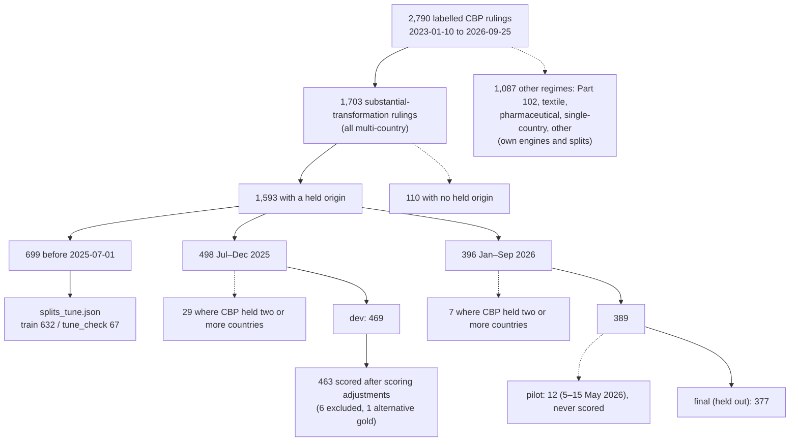

# How the evaluation is built, traded off and benchmarked

This page answers three questions: how the validation and test sets are built, what we trade off in the results, and how we keep the benchmark honest. Every number here comes from a committed file. The figures and the calibration numbers are rebuilt by two scripts with no model calls:

```bash
python3 -I eval/charts/build_evaluation.py .           # writes eval/results/evaluation-metrics.json and docs/img/*.svg
python3 -I eval/charts/build_evaluation.py . --check   # fails if those files are stale
python3 -I eval/charts/build_accuracy.py .             # model sweep, second held-out split, calibration layer (section 6)
cd backend && go run ./cmd/claimscheck                 # recomputes the headline counts and checks docs/claims-reconciliation.md
```

Status words follow [NUMBERS.md](NUMBERS.md): **measured** means recomputed from committed rows; **reported** means stated in a committed document but not recomputable here; **planned** means not done.

## 1. What we measure and why

A user gives the engine a product description and gets back a country of origin, a confidence and the earlier CBP rulings it relied on. They make one decision from that answer: **accept it, or send the case to a customs expert.** The product makes that decision with a bar. A case with confidence at or above 0.92 that the router places in scope is auto-accepted (the fast path); everything else goes to expert review.

So we measure three things, in this order:

1. **Accuracy on every case**: does the predicted origin match the origin CBP held?
2. **Accuracy of the cases we accept, and how many we accept**: the fast path's accuracy and coverage. A wrong auto-accepted answer is the costly error, because nobody checks it.
3. **Whether the confidence means what it says**: calibration.

Cost per case and latency are measured on the same rows. The planner's precedent check has its own, smaller evaluation (section 3.2).

## 2. How the validation and test sets are built

### 2.1 From 2,790 rulings to the splits

The source is 2,790 CBP rulings dated 2023-01-10 to 2026-09-25 from rulings.cbp.gov (`eval/data/labels.jsonl`). Each row has the ruling date, the origin regime, CBP's held origin and how that label was extracted. The counts below are measured by `eval/charts/build_evaluation.py` (`funnel` in `eval/results/evaluation-metrics.json`).



| Step | Before dev (to 2025-06-30) | dev window (Jul–Dec 2025) | final window (2026) |
|---|---:|---:|---:|
| Substantial transformation, multi-country, a held origin | 699 | 498 | 396 |
| CBP held two or more countries ("A or B") | 27 | 29 | 7 |
| Single held origin | 672 | 469 | 389 |
| Pilot cases removed | — | — | 12 |
| **In the split** | train 632 + tune_check 67 | **dev 469** | **final 377** |

The two eval splits are frozen in `eval/splits/splits_final.json` (frozen 2026-10-14). Both contain only single-origin substantial-transformation rulings.

| Split | n | Dates | Collections | Labels | Use |
|---|---:|---|---|---|---|
| dev | 469 (463 scored) | 2025-07-01 to 2025-12-31 | 454 NY, 15 HQ | 448 regex, 21 manual | choose prompts, the bar, the router |
| final (held out) | 377 | 2026-01-02 to 2026-09-25 | 364 NY, 13 HQ | 355 regex, 22 manual | scored with the frozen configuration only |
| pilot | 12 | 2026-05-05 to 2026-05-15 | 10 NY, 2 HQ | 12 regex | taken out of 2026 before the freeze; never scored |
| train / tune_check | 632 / 67 | before 2025-07-01 | — | — | fine-tuning experiment only (`backend/cmd/eval/tune.go`, `tuneSplit`; 10% by FNV-1a hash of the ruling ID) |

Other splits, each built by a committed script and frozen before its held-out run:

- **Textile** (`eval/splits/splits_textile.json`, `build_textile_split.py`): dev 99, final 71.
- **Pharmaceutical** (`splits_pharma.json`, `build_pharma_split.py`) and **Part 102** (`splits_usmca.json`, `build_usmca_split.py`): final 56 and 32.
- **Regression slice** (`eval/splits/slice30.json`): 30 dev rulings stratified by confidence band (`backend/internal/evalslice`, `Pick`).
- **Second held-out split** (`eval/splits/splits_final2.json`, `build_final2_split.py`, D150): 83 substantial-transformation rulings dated 28 Sep to 13 Nov 2026, built with the same rule from rulings published after the first split and frozen on 21 Nov before any scoring. Section 6.

### 2.2 The exclusions, reconstructed

The script that cleaned 396 eligible 2026 rulings to 389, and 498 to 469 in the dev window, is not in this repository. We reconstructed it from `labels.jsonl` alone. One rule reproduces both counts exactly: **drop rulings whose held origin names two or more countries** (stored as `"A | B"`, for example "the body spray mists will be Singapore or Thailand"). Every excluded ruling has such a label, and every such ruling in those windows is excluded. There is no single right answer to score these against, so leaving them out is defensible. It does mean the benchmark is silent on the "it depends" cases.

Two more steps are documented:

- **Pilot.** 12 May 2026 rulings were used to try the pipeline before the freeze and were then removed from final. They have never been scored.
- **Scoring adjustments** (`eval/data/scoring_adjustments.json`, D23), applied identically to every run. Six dev rulings are excluded: four multi-scenario holdings, one revocation covering two products with different origins, and one holding "the country where the blanks are worked". One dev ruling (N354448) accepts either of two countries. A scan of final flagged one ruling (H360070); its label was correct, so nothing changed. Final has no adjustments.

One mismatch we found: the tune split's `rule` says "single-origin", but 27 of its 699 rulings carry a two-or-more-country label. The tune split only fed a fine-tuning experiment that was not adopted (section 3.3), so no reported accuracy depends on it.

### 2.3 Leakage controls

| Control | What it does | Where |
|---|---|---|
| Date split | dev ends 2025-12-31; final starts 2026-01-02 | `splits_final.json`; checked by claimscheck (`temporal.final_starts_after_dev_ends`) |
| Precedents strictly earlier | a retrieved precedent must be dated before the case, and is never the case itself or a ruling the case excludes | `domain.Ruling.UsableAsPrecedentFor`, `retrieval.PrecedentFilter`; claimscheck counts 0 of 1,885 held-out precedent slots on or after their case |
| Facts only | the engine reads the facts section, cut at the first legal-analysis cue; sentences that state the origin conclusion are redacted | `corpus.SplitFacts` |
| Held-out gate | `eval run -split final` refuses to run without `-confirm-final` and prints "do not change prompts, thresholds or retrieval because of its result" | `backend/cmd/eval/main.go` |
| Run log | every run appends its config, git revision and a `held_out` flag to `eval/results/RUNLOG.jsonl` | `eval/results/RUNLOG.jsonl` |

**Known leak paths, measured:**

- **Earlier held-out rulings can be precedents for later ones.** The filter is by date, not by split. 414 of the 1,885 retrieved precedent slots on final are themselves final rulings, touching 209 of 377 cases ([claims-reconciliation.md](claims-reconciliation.md) §4.2). A case never sees its own holding, but it can see a February 2026 holding when the case is from May. This matches how the product works (it uses every earlier ruling), but it is not a fully sealed test set.
- **BM25 statistics** (IDF, average length) are computed over the whole corpus, including later rulings (D10). That leaks term counts, not text or holdings.
- **Model pre-training** may have seen some 2026 rulings. We cannot exclude that.

### 2.4 Labels: where they come from and how they were checked

The label is **CBP's stated holding**: the origin CBP held in the ruling, not our opinion of the right answer.

- 2,696 labels are extracted by regex from the holding sentence; 94 were set by hand where the regex failed. On final, 355 are regex and 22 manual. Accuracy by label method on final: regex 321/355 = 90.4% (86.9–93.1), manual 19/22 = 86.4% (66.7–95.3) (`eval/RESULTS.md`).
- Reported quality checks: a second extractor and a 30-item audit, not an expert panel ([DETAILS.md](DETAILS.md#limitations)). The audit records are not in this repository.
- Six labels the model, acting as a judge, called wrong were checked by hand against the ruling text. All six matched CBP (D23).
- Data files are pinned by `eval/SHA256SUMS` (`make verify-data`).

## 3. What we trade off

### 3.1 Accuracy against coverage: the confidence bar


Measured, `eval/results/evaluation-metrics.json` (`selective`). The curve accepts on confidence alone. The production fast path also requires the router to place the case in scope, which removes 6 more held-out cases.

| Rule | Held-out: accepted | Held-out: accuracy of accepted | Development set (adjusted) |
|---|---|---|---|
| accept everything | 377 (100%) | 90.2% (86.8–92.8) | 91.1% (88.2–93.4) |
| confidence ≥ 0.92 | 306 (81.2%) | 96.1% (93.3–97.7) | 373 (80.6%) at 96.5% |
| **confidence ≥ 0.92 and in scope (fast path, in use)** | **300 (79.6%)** | **96.0% (93.1–97.7)**, 12 wrong | 368 (79.5%) at 96.5% (94.1–97.9) |
| confidence ≥ 0.95 | 271 (71.9%) | 97.8% (95.3–99.0) | 333 (71.9%) at 97.3% |
| confidence ≥ 0.95 and in scope (the old fast path) | 266 (70.6%) | 97.7% (95.2–99.0), 6 wrong | not recomputed here |

**The choice.** We moved the bar from 0.95 to 0.92 (D32). The rule was the lowest bar at which accuracy of accepted cases stays at or above 95%. It was chosen on the proxy dev run; held-out confirmed it and was not used to search for it. On held-out, the cost is 1.7 points of accuracy on accepted cases (97.7% to 96.0%) for 9 points more coverage (70.6% to 79.6%). That is 34 more cases that skip review, and 6 more wrong answers auto-accepted: 12 in all, 3.2% of every held-out case. The intervals of the two rules overlap.

**Not adopted:** per-product-family bars fitted on dev (D63). On held-out they covered less (76.1%) at lower accuracy (94.1%), with 17 wrong auto-accepts instead of 12 (`eval/RESULTS.md`).

For scale only, simple rules on all 377 cases, recomputed from the committed facts with no model (`go run ./cmd/eval baselines`, D155): the first country named in the facts is right on 63.4% (58.4–68.1), the most-mentioned country on 60.7% (55.7–65.5). The research figure for the second, 60.5%, is one case away; it stays labelled unverified where it is quoted, because its own source is not in this repository. These are numbers on all cases, so they are not compared with the fast path, which is a subset the model chose.

### 3.2 Precision against recall in the planner's precedent check

A plan is shown only if the precedent check finds an earlier ruling where CBP treated the same kind of change as decisive, at verifier confidence 0.92 or more. We set this strictly on purpose: a wrong "this move works" costs the user a factory move.

| | Result | Source |
|---|---|---|
| verifier-v1, 54 dev flip pairs | precision 34/34 (90–100), recall 34/46 = 74% (60–84), specificity 8/8 | `eval/RESULTS.md` |
| verifier-v2 (current), same pairs | precision 32/32 (89–100), recall 69.6% (55.2–80.9), specificity 8/8 | `flips-dev-verifier-v2-unknown-a-litellm.jsonl` |
| every v2 run pooled, at the 0.92 bar (D86) | 182 verdicts shown, 0 wrong (dev 159, 2026 pairs 23) | `eval/results/flips-*-verifier-v2*` |
| pair level, dev | 13 of 46 real changes shown in every run (28%); 11 more in some runs; no no-change pair ever shown | D86 |

**The choice.** Precision over recall. About 30% of real origin changes clear the bar. The rest are not dropped: they go to a broker as "below the bar", with the closest supporting ruling. All of these are proxy runs on development pairs; the 2026 pairs are not a clean held-out test (section 5).

### 3.3 Model size against cost and latency

All on the development set (adjusted, n = 463), same engine-v1 prompt, BM25, K = 5. Paired comparisons use an exact McNemar test on the cases where the two models disagree.

| Model | Accuracy | Fast path (≥ 0.92) | Latency p50 / p95 | Cost / case | vs Argon |
|---|---|---|---|---|---|
| **Gemini 4 Argon (in use)** | 91.1% (88.2–93.4) | 79.5% at 96.5% | 4.8 s / 8.1 s | $0.0079 promo | — |
| Gemini 3.8 Flash (fallback) | 90.1% (87.0–92.5) | 87.7% at 93.1% | 5.5 s / 21.6 s | not priced | fixed 13, broke 18, p = 0.473 |
| Gemini 3.5 Flash, untuned | 90.5% (87.5–92.8) | 91.6% at 92.0% | 12.1 s / 51.2 s | $0.017 | fixed 16, broke 19, p = 0.736 |
| Gemini 3.5 Flash, fine-tuned | 87.9% (84.6–90.6) | 94.0% at 89.4% | 6.0 s / 17.1 s | $0.0248 | fixed 15, broke 30, p = 0.036 |
| Gemini 4 Argon, gateway (21 Nov) | 91.8% (88.9–94.0) | 81.0% at 95.7% | 6.8 s / 10.8 s | $0.0079 | fixed 8, broke 5, p = 0.58 |
| Gemini 4 Carbon, gateway (21 Nov) | 88.1% (84.9–90.8), 27 failed calls | 81.9% at 96.3% | 13.0 s / 52.2 s | $0.0155 | fixed 6, broke 20, p = 0.009 |
| Gemini 3.1 Pro preview, gateway (21 Nov) | 87.3% (83.9–90.0), 10 failed calls | 83.6% at 92.8% | 10.6 s / 24.7 s | $0.0178 | fixed 12, broke 30, p = 0.008 |

Source: `eval/RESULTS.md`, `eval/results/dev-*-vertex.jsonl` and, for the 21 Nov rows, `eval/results/accuracy-v2-metrics.json` (gateway runs, D151; cost as the gateway reported it). A failed call counts as wrong.


**21 Nov sweep (D152, D153).** The newer models do not beat Argon. Carbon's failures used its whole 8,000-token output budget on thinking; on the 436 cases it answered it matches Argon (408 against 406 right, p = 0.77), at twice the cost and a 52 s p95. 3.1 Pro preview is lower even on the cases it answered (p = 0.05). A majority vote of Argon, Carbon and 3.1 Pro reaches 91.6% at five times the cost. The gateway and Vertex agree on Argon (p = 0.58).

**The choice.** Argon. Overall accuracy does not separate the base models (p ≥ 0.47). What separates them is the confident subset: only Argon keeps the fast path at or above the 95% the bar is set for, and it has the lowest tail latency. The Flash models say "confident" more often and are wrong more often when they do. Fine-tuning made accuracy significantly worse (p = 0.036), so it was dropped. None of these alternatives was run on held-out.

### 3.4 Retrieval and prompt complexity against gain

Every change below was tried on dev, paired against the plain engine, and **not adopted**. These were proxy runs (LiteLLM, same Argon model).

| Change | Dev accuracy | Fixed / broke | p | Cost / case |
|---|---|---|---|---|
| Baseline: BM25, 5 precedents (n = 469) | 90.0% | — | — | $0.0079 |
| BM25 top 30 re-ranked by embeddings | 88.9% | 7 / 12 | 0.36 | $0.0078 |
| Embedding retrieval only | 89.8% | 5 / 6 | 1.00 | $0.0077 |
| 5 votes over precedent orders when confidence < 0.95 | 89.6% | 2 / 4 | 0.69 | $0.0169 |
| Written CBP rules for the confident errors (n = 463) | 91.1% vs 90.9% | 10 / 9 | 1.0 | — |
| CBP's reasoning shown with each precedent (n = 463) | 91.4% vs 90.9% | 7 / 5 | 0.77 | $0.0095 vs $0.0084 |
| rules-v2: a rule for assemblies around one imported component (n = 463, 21 Nov, D157) | 90.9% vs 91.8% | 9 / 13 | 0.52 | $0.0086 vs $0.0079 |
| Adjudicator, narrow: a second call with contrastive China precedents when the engine named another country under 0.96 (n = 463, D163, D164) | 90.1% vs 91.1% | 2 / 7 | 0.18 | $0.0098 vs $0.0079 |
| Adjudicator, symmetric: the same call whenever the facts name China and confidence is under 0.95 (D164) | 90.9% vs 91.1% | 9 / 10 | 1.0 | $0.0100 vs $0.0079 |
| Adjudicator, symmetric, keeping only its moves away from China (computed, chosen after seeing the two above; D164) | 92.0% vs 91.1% | 7 / 3 | 0.34 | $0.0100 vs $0.0079 |

Source: `eval/RESULTS.md`, D22, D27, D28, D157, D164. The adjudicator rows are paired against the Vertex AI dev rows they were applied to.

**The choice.** Keep plain BM25 and one call. No change moved accuracy by more than half a point, and none was significant. The added parts cost money or latency for no measured gain. The held-out split was therefore not re-scored for any of them.

## 4. How we benchmark properly

### 4.1 What is in place (built)

- **Frozen protocol.** Engine-v1, BM25, K = 5, Gemini 4 Argon, router-v2, bar 0.92 were fixed before the held-out run. The split file records its freeze time.
- **Held-out scored with a gate.** `-confirm-final` is required, for `final` and for `final2`. The engine's held-out split appears twice in `RUNLOG.jsonl`, both with the frozen configuration: once through the proxy (89.9%) and once on Vertex AI (90.2%, the official figure). Nothing changed between them (McNemar p = 1.0). The specialist engines each have one held-out run. The second held-out split has one run, of the candidate pre-registered in D153 (section 6).
- **Intervals on every proportion.** 95% Wilson intervals (`backend/internal/evalkit`, `Wilson`). Small-n numbers are never shown without one.
- **Paired tests for comparisons.** Two runs on the same cases are compared with an exact McNemar test on the discordant cases (`eval compare`; `mcnemarExact` in `backend/cmd/eval/main.go`), not by eyeballing two accuracies.
- **Repeatable calls.** Temperature 0 on every model call, and since 17 Oct a fixed seed, 20261017 (`llm.Seed`, D76). The official held-out run (15 Oct) predates the seed. Google treats the seed as best effort.
- **Resumable, logged runs.** Every run appends its model, prompt version, provider, K, git revision and held-out flag to `RUNLOG.jsonl`. Every per-case row records the model and prompt version it used.
- **Independent recomputation.** `go run ./cmd/claimscheck` recomputes the headline counts from the committed rows, checks the checksums of every file it reads and fails if [claims-reconciliation.md](claims-reconciliation.md) states a different value. It runs offline with the standard library only.
- **Prompt fingerprints.** `backend/internal/promptsnap` fails the tests when a prompt's text changes but its version name does not, so a recorded `prompt_version` always means the same text.
- **Regression slice.** `eval-slice.yml` runs the engine on the 30-case slice on Vertex after a push to main that touches the engine, router, clarify or verifier. It fails if more than 2 cases are lost or if accuracy at confidence ≥ 0.95 falls under 95%. Pull requests get the offline prompt-fingerprint check instead, because they have no model credentials.

### 4.2 Calibration, computed now

The per-case held-out and dev rows include the stated confidence, so calibration needs no model calls. Measured by `eval/charts/build_evaluation.py` (2,000 bootstrap resamples, seed 20261017, percentile intervals):

| | Held-out (n = 377) | Development set (n = 463, adjusted) |
|---|---|---|
| Accuracy | 90.2% | 91.1% |
| Mean stated confidence | 94.7% | 94.9% |
| ECE, one bin per emitted confidence value | 0.059 (0.041–0.091) | 0.050 (0.033–0.078) |
| ECE, 10 equal-width bins | 0.046 (0.022–0.074) | 0.038 (0.016–0.063) |
| Brier score | 0.081 (0.059–0.105) | 0.072 (0.051–0.094) |
| Brier of a constant forecast at the accuracy rate | 0.089 | 0.081 |


What this says:

- **The confidence is overconfident by about 4.5 points on average** (94.7% stated, 90.2% observed).
- **Above the bar it is close to calibrated.** At 0.95 and above, observed accuracy is 95.8% to 100% per value.
- **Just below the bar it is not.** Cases scored 0.92 are right 29/35 = 82.9% of the time; 0.90 is 21/29 = 72.4%; 0.85 is 16/29 = 55.2%. These go to review, which is where they belong.
- **The confidence ranks cases better than it states probabilities.** The Brier score is only about 9% better than a constant forecast. Its value is in ordering cases, which is what the bar uses.

**A calibration layer (D156, built in the eval, not in the API).** An isotonic map from stated confidence to observed accuracy, fitted on the 463 development rows only and capped at 0.99, then applied unchanged to the held-out rows. On the 377: ECE 0.059 → 0.030 (0.020–0.059), Brier 0.081 → 0.072 (0.056–0.092), mean stated 94.7% → 90.4% against 90.2% right. On the second held-out split (83): ECE 0.067 → 0.038, Brier 0.060 → 0.051. The map is monotone, so it ranks cases exactly as before; only the stated number changes.


**In the product since D160 (cal-v2).** The server applies the same kind of map, refitted with one change: a confidence value with fewer than 20 development cases is pooled with its neighbour before the fit. That removes cal-v1's lowest step, one wrong case at 0.65 mapped to 0.0. The map is generated into `backend/internal/calibrate/map.json` by `eval/charts/build_accuracy.py`, embedded in the server, and applied only to engine-v1 answered by Gemini 4 Argon. The API returns it as `calibrated_confidence` beside the stated `confidence`; the MCP tools and the Result screens show it. Held-out, computed once from the committed rows:

| | 377 (Vertex AI) | final2, 83 (gateway) | both, 460 |
|---|---|---|---|
| Mean stated → calibrated (accuracy) | 94.7% → 90.2% (90.2%) | 96.1% → 93.8% (92.8%) | 95.0% → 90.9% (90.7%) |
| ECE, one bin per value, stated → cal-v2 | 0.059 → 0.028 (0.020–0.060) | 0.067 → 0.037 (0.030–0.099) | 0.055 → 0.026 (0.018–0.053) |
| Brier, stated → cal-v2 | 0.081 → 0.072 (0.056–0.092) | 0.060 → 0.051 (0.020–0.089) | 0.077 → 0.069 (0.053–0.085) |

cal-v2 is level with cal-v1 on every row (cal-v1: ECE 0.030, 0.038 and 0.027); the intervals overlap fully.

**The auto-accept bar on calibrated confidence (D160).** Fitted on dev by a rule written first: the lowest step of the map at which the in-scope cases at or above it are at least 96% right, with at least 100 cases. On dev the steps give:

| Calibrated bar (at or above) | Auto-accepted and in scope (dev, 463) | Right (95% CI) |
|---|---|---|
| 0.99 (stated 0.98 and up) | 238 = 51.4% | 99.6% (97.7–99.9) |
| 0.9355 (stated 0.96–0.97) | 269 = 58.1% | 98.9% (96.8–99.6) |
| 0.9016 (stated 0.95) | 328 = 70.8% | 97.3% (94.9–98.5) |
| **0.90 (stated 0.92–0.94), chosen** | 368 = 79.5% | 96.5% (94.1–97.9) |
| 0.7778 (stated 0.90–0.91) | 412 = 89.0% | 94.4% (91.8–96.3) |
| 0.60 (stated below 0.90) | 455 = 98.3% | 91.0% (88.0–93.3) |

The rule picks 0.90, the step stated 0.92 maps to, so the product accepts exactly the cases it accepted before. The published auto-accept figures do not change: 377 held-out, 300 = 79.6% at 96.0% (93.1–97.7); final2, 75 = 90.4% at 97.3% (90.8–99.3); dev, 368 at 96.5%. `go run ./cmd/claimscheck` recomputes these from the map and the rows in Go and fails if the calibrated bar and the stated 0.92 bar ever accept different cases.

The model emits about 11 distinct confidence values, so the first ECE uses one bin per value. The standard 10-bin ECE puts every case from 0.90 to 1.00 in one bin and reads lower. ECE on a few hundred cases is biased upward; the intervals show how wide it is.

### 4.3 What we'd add next (planned)

- **Multi-run variance.** The official engine numbers are one scored run. Earlier proxy runs moved fast-path coverage by about 3 points between runs (`eval/RESULTS.md`). Three or more seeded runs on dev would give a measured spread.
- **Bootstrap intervals for paired differences**, alongside McNemar, so the size of a difference gets an interval and not only a p-value.
- **A clean planner test set** from CBP rulings published after 25 Sep 2026, once enough exist with an origin holding (D82). The engine now has one (section 6); the planner's flip pairs do not.
- **Scoring the other regimes on post-cutoff rulings.** 18 Part 102 and 12 pharmaceutical rulings after 25 Sep are labelled (`eval/data/labels_final2.jsonl`) but not scored.
- **Re-running the specialist engines on Vertex.** The pharmaceutical and Part 102 held-out numbers are proxy runs.

## 5. Known gaps

- **Stated confidence is a self-report.** It is overconfident on average (section 4.2). The product shows a calibrated confidence for the general engine on Gemini 4 Argon (D160); the textile, Part 102 and pharmaceutical engines and the fallback model still show stated confidence only. The map is fitted on one development window and checked on two held-out splits; it will drift if the model or prompt changes.
- **One scored run** per configuration on each held-out split. Run-to-run variance is not measured for the official numbers. Two dev runs of the same Argon configuration (Vertex and the gateway) differ by 13 cases (8 one way, 5 the other).
- **Two baselines are still unverified.** Most-mentioned (60.7%) and majority (12.2%) are recomputed (D155); final-assembly 40.6% and last-mentioned 39.8% come from a research document that is not in this repository and are not reproduced.
- **The split's cleaning script is not committed.** We reconstructed the rule (section 2.2) and it reproduces the counts exactly, but it is a reconstruction.
- **The test set is not sealed against itself.** Earlier held-out rulings serve as precedents for later ones (414 of 1,885 slots).
- **The benchmark leaves out "A or B" holdings** (36 in the dev and final windows), which are real and harder cases.
- **Labels are one pipeline plus a small audit**, not an expert panel, and the audit records are not committed.
- **Inputs are CBP's restatements** of each request, not raw manufacturer BOMs. Real inputs will be messier.
- **The planner is the least tested part.** Its precedent check now has a clean post-25-Sep test (section 7), but only 15 pairs, so the intervals are wide; plan quality on the 13 families is checked on development rulings, not evaluated.
- **Proxy runs.** Pharmaceutical and Part 102 held-out numbers, every ablation in section 3.4, the 21 Nov model sweep, the second held-out split and every precedent-check result came through the LiteLLM proxy or gateway with the same Gemini model, not the official Vertex AI path. Gateway and Vertex AI agree on the development set (same engine and model, exact McNemar p = 0.58, D151); these runs were not repeated on Vertex AI.
- **The second held-out split is small and easier.** 83 rulings, 62 distinct subjects, and the most-mentioned-country rule gets 71.1% of it (60.7% on the first). It confirms the engine holds up after its cutoff; it does not show it improved.

## 6. The second held-out split (21 Nov 2026)

**Why.** The 377-ruling split had been scored and reported. To check the headline on rulings nobody had seen, and to score any new candidate cleanly, we built a second test set from CBP rulings published after 25 Sep 2026 and froze it before scoring anything on it (D150).

**How it was built.**

| Step | Count | Source |
|---|---:|---|
| Ruling numbers tried on rulings.cbp.gov (N362500–N367300, H361000–H362333) | 6,135 | `eval/data/final2_probe.jsonl` |
| Rulings found | 1,013 | same |
| Origin rulings dated 26 Sep 2026 or later, saved and labelled | 163 | `eval/data/labels_final2.jsonl` |
| Substantial transformation, facts naming two or more countries | 85 | `eval/splits/splits_final2.json` (`funnel`) |
| CBP held two or more countries (excluded) | 2 | same |
| **In the split** (28 Sep to 13 Nov 2026, all New York rulings) | **83** | same |

- CROSS's search endpoint refuses scripted requests, so rulings were found by number at about one request a second (`go run ./cmd/corpus probe`). Headquarters numbers are assigned at intake, so few recent HQ rulings were found; none is in the split. Rulings CBP had not yet posted are missing.
- Labels come from the same regex holding extractor that produced `labels.jsonl` and a reconstructed regime rule. Re-run on all 2,790 earlier rulings, the extractor reproduces every one of the 1,620 regex-labelled substantial-transformation origins; the regime rule finds substantial transformation with precision 97.6% and recall 98.4% (`eval/data/final2_labeller_check.json`). Two holdings the regex missed were set by hand with the sentence and a reason (`eval/data/final2_manual.json`). The checks were made by the agent that built the split, not by a customs expert.
- Leakage controls are the same as for the first split (section 2.3). Every precedent is a ruling dated before the case, from either label file; earlier rulings of the new split can be precedents for later ones.

**Candidate and result.** The candidate was chosen on dev only and written down before the split was scored (D152, D153): engine-v1 on Gemini 4 Argon, unchanged, because no newer model or prompt beat it (section 3.3, 3.4). Scored once, through the gateway with the router (D154). Gateway and Vertex AI agree on the development set (same engine and model, exact McNemar p = 0.58, D151); these runs were not repeated on Vertex AI.

| Held-out set | n | Accuracy (95% CI) | Fast path (≥ 0.92, in scope) | Path |
|---|---:|---|---|---|
| First (Jan–Sep 2026) | 377 | 90.2% (86.8–92.8) | 79.6% at 96.0% (93.1–97.7) | Vertex AI |
| Second (Sep–Nov 2026) | 83 | 92.8% (85.1–96.6) | 90.4% at 97.3% (90.8–99.3) | gateway |
| Both | 460 | 90.7% (87.6–93.0) | 81.5% at 96.3% (93.8–97.8) | mixed |

**What it shows, and what it does not.** The engine holds up on rulings published after everything it was built and tuned on. It does not show an improvement: the intervals overlap, the second split is easier for simple rules (most-mentioned country 71.1% against 60.7%; `eval/results/baselines-final2.json`), and it has near-duplicates (62 distinct subjects among 83 rulings; counting each subject once gives 91.9%). Four of its six errors are CBP holding China where the engine named the assembling country, the same weakness as before. Production is unchanged.

## 7. Planner (21 Nov 2026)

**Why.** A plan is shown only when the precedent check finds an earlier ruling where CBP treated the same kind of change as decisive (section 3.2). Until now that check was measured on development pairs and on 2026 pairs that informed its prompt. CBP rulings published after the 25 Sep 2026 cut-off make a clean test possible (D170). Separately, each of the 13 plan families had been tried on one product (D171).

### 7.1 Post-cutoff flip pairs (D170)

**How the set was built.** A cheap model proposed candidate pairs for the 85 post-cutoff substantial-transformation rulings; each kept pair was read by hand (facts and holding of both rulings) and frozen before scoring (`eval/data/flips_post.jsonl`, rule and rejected candidates in `eval/data/flips_post_meta.json`, pinned in `eval/SHA256SUMS`).

| | Pairs | Source |
|---|---:|---|
| Real origin changes (core / edge) | 11 (6 / 5) | `eval/data/flips_post.jsonl` |
| Controls: work moved, CBP kept the origin | 4 | same |
| With a plan template (the product's family check) | 6 | `eval/results/planner-post-familycheck-litellm.jsonl` |

**Precedent check, scored once** (production configuration: verifier-v2 on Gemini 4 Argon, precedent-check bar 0.92, local corpus search, gateway). Gateway and Vertex AI agree on the development set (same engine and model, exact McNemar p = 0.58, D151); these runs were not repeated on Vertex AI. A move counts as right only if CBP's later ruling changed the origin and the check named that origin.

| | CBP's starting origin given | Not given |
|---|---|---|
| Shown at the 0.92 bar that were right | 8 of 8 (67.6–100) | 4 of 5 (37.6–96.4) |
| Real changes shown and right | 8 of 11 = 72.7% (43.4–90.3) | 4 of 11 = 36.4% (15.2–64.6) |
| Core pairs only | 5 of 6 shown, all right | 1 of 2 shown right |
| Controls shown | 0 of 4 | 0 of 4 |
| Cost | $0.58 for 15 checks | $0.59 |

Rows: `eval/results/flips-post-verifier-v2-{known-a,unknown-a}-litellm.jsonl`; every pair's outcome, with the cited rulings and a hand note on whether the cited ruling supports the move, is in `eval/results/planner-post-summary.json`.

| Pair | Product | Tier | CBP: start → later | Check, starting origin given | Not given |
|---|---|---|---|---|---|
| BA-N366512-N366513 | Cabin air filter | core | China → Thailand | shown, right, 0.96 (N353724) | shown, right, 0.97 |
| BA-N364414-N365093 | Metal windchime | core | China → Vietnam | shown, right, 0.96 (N361370) | below the bar, 0.85 |
| BA-N364386-N365094 | Lantern wax warmer | core | China → Vietnam | shown, right, 0.92 (N345085) | below the bar, 0.90 |
| BA-N357855-N365344 | Electric stove heater | core | China → Thailand | shown, right, 0.92 (N347421) | below the bar, 0.90 |
| BA-N356030-N364865 | Strut assembly | core | China → Thailand | shown, right, 0.94 (N339174) | missed |
| BA-N365280-N360430 | Fracking unit | core | China → UAE | missed (no change seen) | **shown, wrong later origin, 0.92** |
| SP-N341280-N366550 | USB / SD card hub | edge | China → Philippines | shown, right, 0.97 (N339405) | shown, right, 0.96 |
| SP-N339156-N365363 | Wrapping paper | edge | Finland → Germany | missed | below the bar, 0.75 |
| SP-N365961-N366717 | Plywood | edge | Malaysia → Tanzania | shown, right, 0.96 (N347656) | shown, right, 0.96 |
| SP-N365621-N365615 | Pneumatic wrench | edge | China → Malaysia | below the bar, 0.78 | missed |
| SP-N355546-N365797 | Power MOSFET | edge | United States → South Korea | shown, right, 0.97 (N344105) | shown, right, 0.96 |
| NEG-N365621-N366380 | Pneumatic ratchet wrench | control | China → China | not supported | supported below the bar, 0.78 (wrong) |
| NEG-N366164-N366163 | Champ air purifier | control | Vietnam → Vietnam | not supported | not supported |
| NEG-N366166-N366165 | Mighty air purifier | control | Vietnam → Vietnam | not supported | not supported |
| NEG-N366168-N366167 | Waffle Cone air purifier | control | Indonesia → Indonesia | not supported | not supported |

Read by hand, the ruling cited for each of the 8 shown moves supports it in 5; in 3 (windchime, wax warmer, heater) it points the right way with a different product, several scenarios, or a conflict with CBP's holding on the starting setup.

**Plan search on the pairs with a template, once each** (`eval/results/planner-post-plan-*-litellm.json`, $0.76):

| Fixture | CBP's later setup | Result |
|---|---|---|
| Strut assembly, target Thailand | shock absorber tube and piston rod made in Thailand | CBP's move is the top plan (0.96); backtest: it moves exactly those parts |
| Stove heater, target Thailand | motor and housing made, and the unit assembled, in Thailand | CBP's move is shown (0.92), but the top-ranked plan is a cheaper subset, the motor alone (0.92), which CBP never ruled on. The planner cannot move final assembly |
| Three air purifiers, reverse probe to China | a Chinese motor (and filters) kept the local origin | no plan shown. For the Waffle Cone the engine predicted China for the motor move and the check supported it at 0.85: only the bar kept a wrong plan off the screen |

**What it shows, and what it does not.** On rulings published after everything the check was written from, nothing wrong cleared the bar when CBP's starting origin was given, and about three in four real changes did. Without the starting origin the check is weaker and showed one wrong plan. The set is small (11 real changes), read by one person, scored through the gateway with local search, and a few pairs repeat patterns the check has seen. It is evidence about the precedent check, not about plan quality in general. The plan search reached CBP's move in both real changes it could express, and can rank an untested cheaper subset above it.

### 7.2 Per-family plan checks (D171)

Two products per family from development or train rulings (never a test split), picked by a fixed rule (`eval/planner/family_picks.py`); one predict + plan search each through the gateway. China-held setups first; families with none use a reverse probe. The ruling each shown plan cites was read by hand.

| Family | Products (CBP held → target) | Precedent-supported plan | Cited ruling supports the move | Cost |
|---|---|---|---|---|
| PCBA-based devices | N350727 (China → Thailand), N352230 (China → Malaysia) | 1 of 2 | 1 supports | $0.14 |
| Vehicle parts | N349871 (China → Thailand), N352073 (China → Philippines) | 2 of 2 | 1 partial, 1 does not | $0.08 |
| Cables and harnesses | N350058, N350769 (China → Thailand) | 2 of 2 | 1 supports, 1 does not | $0.23 |
| Motorised tools and appliances | N350310 (China → United States), N351922 (China → Thailand) | 1 of 2 | 1 partial | $0.53 |
| Power supplies | N352355 (China → Vietnam), N350383 (Indonesia → China) | 2 of 2 | 2 support | $0.09 |
| Hand tools | N352429 (China → Taiwan), N354220 (China → Vietnam) | 1 of 2 | 1 partial | $0.16 |
| LED lights | N335263 (China → Hong Kong), H304679 (China → Cambodia) | 1 of 2 | 1 supports | $0.14 |
| Medical devices | N333453 (China → Japan), N350152 (Japan → China) | 2 of 2 | 1 supports, 1 partial | $0.12 |
| Water filters | H339955 (China → South Korea), N350826 (United States → China) | 1 of 2 | 1 supports | $0.16 |
| Displays and cameras | N352223 (Philippines → Japan), N354175 (Taiwan → China) | 1 of 2 | 1 supports | $0.09 |
| Furniture | N350678 (Vietnam → China), H345343 (United States → China) | 0 of 2 | — | $0.10 |
| Gas grills | N354448 (Indonesia → China), the only eligible ruling | 1 of 1 | 1 supports | $0.06 |
| LiDAR modules | no eligible ruling | — | — | — |
| **All** | 23 | **15 of 23 = 65.2% (44.9–81.2)**; 8 to a broker | 9 support, 4 partial, 2 do not | $1.90 ($0.083 a search) |

The two "does not" cases cite a ruling that holds China for an all-Chinese setup; both plans leave no Chinese part, so they are likely right on their face, but the citation does not show it. Per-run detail, closest rejected move and notes: `eval/results/planner-families-summary.json`, `eval/planner/spot_checks.json`. These are development checks with illustrative economics, one run each; no later ruling tells whether a shown plan would work.

Recompute both summaries with `python3 -I eval/planner/summarize.py . --check` (part of `make reproduce`); the post-cutoff counts are also recomputed by `go run ./cmd/claimscheck` (`planner_post.*`).
