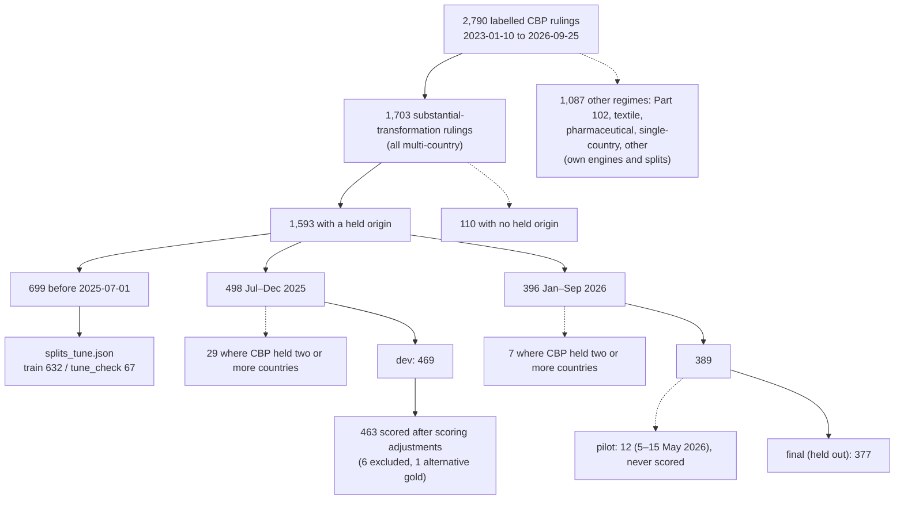
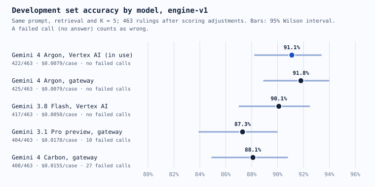
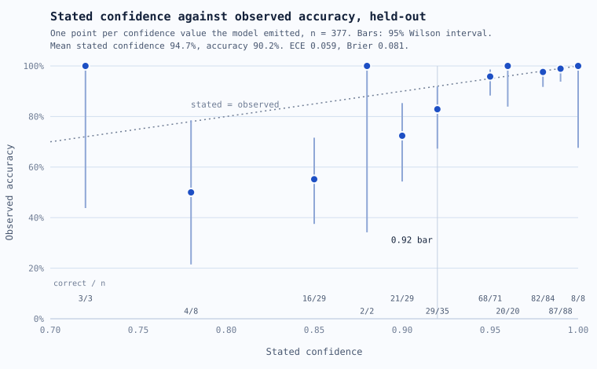
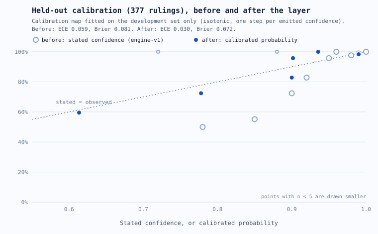

# How the evaluation is built, traded off and benchmarked

This page answers three questions: how the validation and test sets are built, what we trade off in the results, and how we keep the benchmark honest. Every figure here is either computed from a committed file or explicitly labelled reported. The figures and calibration numbers are rebuilt by two scripts with no model calls:

```bash
python3 -I eval/charts/build_evaluation.py .           # writes eval/results/evaluation-metrics.json and docs/img/*.svg
python3 -I eval/charts/build_evaluation.py . --check   # fails if those files are stale
python3 -I eval/charts/build_accuracy.py .             # model sweep, second held-out split, calibration layer (section 6)
cd backend && go run ./cmd/claimscheck                 # recomputes the headline counts and checks docs/claims-reconciliation.md
```

Status words follow [NUMBERS.md](NUMBERS.md): **measured** means recomputed from committed rows; **reported** means stated in a committed document but not recomputable here; **planned** means not done.

## 1. What we measure and why

A user gives the engine a product description and gets back a country of origin, a confidence and the earlier CBP rulings it relied on. They make one decision from that answer: **accept it, or send the case to a customs expert.** The product makes that decision with two bars. The general engine on Gemini 4 Argon uses **calibrated confidence ≥ 0.90** (D160), which accepts exactly the same cases as the historical stated-confidence ≥ 0.92 rule; other engines use their documented stated-confidence bars and the fallback model never auto-accepts. A case in scope at the applicable bar is auto-accepted (the fast path); everything else goes to expert review.

So we measure three things, in this order:

1. **Accuracy on every case**: does the predicted origin match the origin CBP held?
2. **Accuracy of the cases we accept, and how many we accept**: the fast path's accuracy and coverage. A wrong auto-accepted answer is the costly error, because nobody checks it.
3. **Whether the confidence means what it says**: calibration.

Cost per case and latency are measured on the same rows. The planner's precedent check has its own, smaller evaluation (section 3.2).

## 2. How the validation and test sets are built

### 2.1 From 2,790 rulings to the splits

The source is 2,790 CBP rulings dated 2023-01-10 to 2026-09-25 from rulings.cbp.gov (`eval/data/labels.jsonl`). Each row has the ruling date, the origin regime, CBP's held origin and how that label was extracted. The counts below are measured by `eval/charts/build_evaluation.py` (`funnel` in `eval/results/evaluation-metrics.json`).



| Step | Before dev (to 2025-06-30) | dev window (Jul–Dec 2025) | final window (2026) |
|---|---:|---:|---:|
| Substantial transformation, multi-country, a held origin | 699 | 498 | 396 |
| CBP held two or more countries ("A or B") | 27 | 29 | 7 |
| Single held origin | 672 | 469 | 389 |
| Pilot cases removed | — | — | 12 |
| **In the split** | train 632 + tune_check 67 | **dev 469** | **final 377** |

The two eval splits are frozen in `eval/splits/splits_final.json` (frozen 2026-10-14). Both contain only single-origin substantial-transformation rulings.

| Split | n | Dates | Collections | Labels | Use |
|---|---:|---|---|---|---|
| dev | 469 (463 scored) | 2025-07-01 to 2025-12-31 | 454 NY, 15 HQ | 448 regex, 21 manual | choose prompts, the bar, the router |
| final (held out) | 377 | 2026-01-02 to 2026-09-25 | 364 NY, 13 HQ | 355 regex, 22 manual | scored with the frozen configuration only |
| pilot | 12 | 2026-05-05 to 2026-05-15 | 10 NY, 2 HQ | 12 regex | taken out of 2026 before the freeze; never scored |
| train / tune_check | 632 / 67 | before 2025-07-01 | — | — | fine-tuning experiment only (`backend/cmd/eval/tune.go`, `tuneSplit`; 10% by FNV-1a hash of the ruling ID) |

Other splits, each built by a committed script and frozen before its held-out run:

- **Textile** (`eval/splits/splits_textile.json`, `build_textile_split.py`): dev 99, final 71.
- **Pharmaceutical** (`splits_pharma.json`, `build_pharma_split.py`) and **Part 102** (`splits_usmca.json`, `build_usmca_split.py`): final 56 and 32.
- **Regression slice** (`eval/splits/slice30.json`): 30 dev rulings stratified by confidence band (`backend/internal/evalslice`, `Pick`).
- **Second held-out split** (`eval/splits/splits_final2.json`, `build_final2_split.py`, D150): 83 substantial-transformation rulings dated 28 Sep to 13 Nov 2026, built with the same rule from rulings published after the first split and frozen on 21 Nov before any scoring. Section 6.
- **Post-cutoff splits of the other regimes** (`eval/splits/splits_{textile,pharma,usmca}_final2.json`, `build_regimes_final2_split.py`, D210): textile 17, pharmaceutical 6, Part 102 13, from the same 163 labelled rulings, each with its first builder's rule unchanged, frozen before scoring. Section 6.1.

### 2.2 The exclusions, reconstructed

The script that cleaned 396 eligible 2026 rulings to 389, and 498 to 469 in the dev window, is not in this repository. We reconstructed it from `labels.jsonl` alone. One rule reproduces both counts exactly: **drop rulings whose held origin names two or more countries** (stored as `"A | B"`, for example "the body spray mists will be Singapore or Thailand"). Every excluded ruling has such a label, and every such ruling in those windows is excluded. There is no single right answer to score these against, so leaving them out is defensible. It does mean the benchmark is silent on the "it depends" cases.

Two more steps are documented:

- **Pilot.** 12 May 2026 rulings were used to try the pipeline before the freeze and were then removed from final. They have never been scored.
- **Scoring adjustments** (`eval/data/scoring_adjustments.json`, D23), applied identically to every run. Six dev rulings are excluded: four multi-scenario holdings, one revocation covering two products with different origins, and one holding "the country where the blanks are worked". One dev ruling (N354448) accepts either of two countries. A scan of final flagged one ruling (H360070); its label was correct, so nothing changed. Final has no adjustments.

One mismatch we found: the tune split's `rule` says "single-origin", but 27 of its 699 rulings carry a two-or-more-country label. The tune split only fed a fine-tuning experiment that was not adopted (section 3.3), so no reported accuracy depends on it.

### 2.3 Leakage controls

| Control | What it does | Where |
|---|---|---|
| Date split | dev ends 2025-12-31; final starts 2026-01-02 | `splits_final.json`; checked by claimscheck (`temporal.final_starts_after_dev_ends`) |
| Precedents strictly earlier | a retrieved precedent must be dated before the case, and is never the case itself or a ruling the case excludes | `domain.Ruling.UsableAsPrecedentFor`, `retrieval.PrecedentFilter`; claimscheck counts 0 of 1,885 held-out precedent slots on or after their case |
| Facts only | the engine reads the facts section, cut at the first legal-analysis cue; sentences that state the origin conclusion are redacted | `corpus.SplitFacts` |
| Not revoked or modified by then (D320, D370) | a precedent CBP revoked or modified before the case date is skipped; one revoked on the case date or later stays, because it was CBP's position at the case date. This includes a case that is itself the revoking ruling | `domain.SupersededAsOf`, map `backend/internal/domain/supersession.json` from `go run ./cmd/corpus supersession`; effect on committed runs in section 2.5 |
| Held-out gate | `eval run -split final` refuses to run without `-confirm-final` and prints "do not change prompts, thresholds or retrieval because of its result" | `backend/cmd/eval/main.go` |
| Run log | every run appends its config, git revision and a `held_out` flag to `eval/results/RUNLOG.jsonl` | `eval/results/RUNLOG.jsonl` |

**Known leak paths, measured:**

- **Earlier held-out rulings can be precedents for later ones.** The filter is by date, not by split. 414 of the 1,885 retrieved precedent slots on final are themselves final rulings, touching 209 of 377 cases ([claims-reconciliation.md](claims-reconciliation.md) §4.2). A case never sees its own holding, but it can see a February 2026 holding when the case is from May. This matches how the product works (it uses every earlier ruling), but it is not a fully sealed test set.
- **BM25 statistics** (IDF, average length) are computed over the whole corpus, including later rulings (D10). That leaks term counts, not text or holdings.
- **Model pre-training** may have seen some 2026 rulings. We cannot exclude that.

### 2.4 Labels: where they come from and how they were checked

The label is **CBP's stated holding**: the origin CBP held in the ruling, not our opinion of the right answer.

- 2,696 labels are extracted by regex from the holding sentence; 94 were set by hand where the regex failed. On final, 355 are regex and 22 manual. Accuracy by label method on final: regex 321/355 = 90.4% (86.9–93.1), manual 19/22 = 86.4% (66.7–95.3) (`eval/RESULTS.md`).
- Reported quality checks: a second extractor and a 30-item audit, not an expert panel ([DETAILS.md](DETAILS.md#limitations)). The audit records are not in this repository.
- Six labels the model, acting as a judge, called wrong were checked by hand against the ruling text. All six matched CBP (D23).
- Data files are pinned by `eval/SHA256SUMS` (`make verify-data`).

### 2.5 Revoked and modified precedents in committed runs (D320, D370)

Before D320 the precedent filter only checked dates, so a ruling CBP had already revoked could be shown to the engine or cited by the verifier. `python3 -I -B eval/supersession/impact.py .` counts, offline, how often that happened in the committed results (`eval/results/supersession-impact.json`). No model calls; nothing was re-scored, so the effect on accuracy is not measured.

A change counts only for cases dated after the revoking ruling's date (D370). On that date itself the earlier ruling was still CBP's position, and when the case being backtested is the revoking ruling, counting its own change would let the label's document decide what evidence the model sees (#527).

| Committed rows | Rows | Showed a superseded precedent | Cited one |
|---|---:|---:|---:|
| All result rows with rulings (151 files) | 13,645 | 23 | 8 |
| Development engine runs (general) | | 1 (N355148, N331974 shown) | 0 |
| First held-out split, engine (4 runs) | | 8 (N361172 and N364229, N331974 shown) | 3 |
| Textile development runs | | 8 (N345891 shown) | 4 |
| Part 102 development runs | | 6 | 0 |
| Move verifier, flip pairs | | 0 | 0 |
| Heat-gun plan runs (bound 14 Jan 2026) | | 0 | 1 |

- **Same-day cases are not counted (D370).** Under D320's first rule ("on or before the case date") the totals were 43 showed and 10 cited, on 135 files and 12,998 rows at the time. 20 of the 43 and 2 of the 10 were development runs of H325607, the letter that revoked N331974 on its own date. N331974 was CBP's position until H325607 was decided, so showing it for that case was not an error, and the guard no longer hides it there. All 20 of those runs were wrong (19 Spain, one China, where CBP held Thailand); N331974 had held Thailand too, so the shown precedent agreed with the label. Source: the H325607 rows of `eval/results/dev-*-engine-v1*.jsonl`, one per file; they are no longer in `supersession-impact.json` because the recount drops same-day rows.
- **The held-out rows were right anyway.** The 8 held-out rows that showed N331974 were all correct. The held-out accuracy figures are unchanged: they are committed runs, and no held-out split was re-scored.
- **One verifier verdict cited a modified ruling.** In `plan-heatgun-2022-verifier-v2-litellm.json`, a rejected heat-gun move (0.90, below the 0.92 bar) cited N322364, which H323218 modified on 16 Dec 2025, a month before the demo's bound. The shown plan does not cite it. The current flagship plan cites N345938, which is not superseded.
- 342 plan and demo rows carry no date; none of them names any superseded ruling.
- **Customs Bulletin changes add none (D400, D401).** The map now also holds 109 final changes read only from 28 fetched Customs Bulletins, dated by their effective date. The recount with them is the same 23 showed and 8 cited. Only one of those rulings appears in any committed row: N326416 (general pool), shown in 6 textile development rows for a case dated 11 Dec 2025. H342508 modified it effective 18 Oct 2026, after that case, so it was still CBP's position and counts for none (`bulletin_rulings_named` in the same JSON). The 78 pending proposals are never a bar and no committed row names one. The bulletins are a sample, not every issue, so this is a floor for what the bulletin would add.

### 2.6 Revocation alerts on committed results (D480, D481)

A saved case now says when CBP has revoked or modified a ruling it relies on (cited by the prediction, a shown plan's supporting ruling, or the current setup's ruling), and when CBP has only proposed to (built, D480). `go run ./cmd/corpus alerts` applies the same rule to the committed results, offline, as of 22 Nov 2026 (`eval/supersession/alerts.json`). No model calls.

| Committed results | Count | Would show |
|---|---:|---|
| Result rows naming rulings | 13,586 | |
| Relied-on ruling changed on or after the case date | 2 (4 before D490) | the "look again" alert |
| Relied-on ruling changed before the case date | 7 (8 before D490) | the alert, marked as stored before the guard (7 of the 8 of section 2.5; the eighth also cites the revoker) |
| Relied-on ruling with a proposed change only | 0 | a calm line |
| Only a ruling read, not cited, changed | 66 (85 before D490; 2 are D650 checklist rows) | a calm line, no list badge |
| Stored case documents (heat-gun demo seeds and one prediction) | 0 of 7 | |
| Demo fixtures (current-setup and recorded supporting rulings) | 0 of 10 | |

- **The 2 rows** are 2 development runs of one case: N356467 (case date 22 Dec 2025) cites N344694, which H344999 modified on 6 May 2026. The first count (D481) also had 2 runs of H325607 citing N331974, which H325607 itself revoked on its own date. The case was the revoking ruling, so since D490 no alert is raised: a change made by the case itself, or by a ruling it relies on, is not an alert.
- **No proposals.** None of the 78 pending proposals touches a precedent-pool ruling (D401), so no committed answer relies on one.
- **Reading.** On committed data the alert rarely fires. It is meant for saved cases as CBP keeps publishing changes, and it can only be as complete as the map: corpus letters and 28 fetched bulletins.

## 3. What we trade off

### 3.1 Accuracy against coverage: the confidence bar


Measured, `eval/results/evaluation-metrics.json` (`selective`). The curve accepts on confidence alone. The production fast path also requires the router to place the case in scope, which removes 6 more held-out cases.

| Rule | Held-out: accepted | Held-out: accuracy of accepted | Development set (adjusted) |
|---|---|---|---|
| accept everything | 377 (100%) | 90.2% (86.8–92.8) | 91.1% (88.2–93.4) |
| confidence ≥ 0.92 | 306 (81.2%) | 96.1% (93.3–97.7) | 373 (80.6%) at 96.5% |
| **confidence ≥ 0.92 and in scope (fast path, in use)** | **300 (79.6%)** | **96.0% (93.1–97.7)**, 12 wrong | 368 (79.5%) at 96.5% (94.1–97.9) |
| confidence ≥ 0.95 | 271 (71.9%) | 97.8% (95.3–99.0) | 333 (71.9%) at 97.3% |
| confidence ≥ 0.95 and in scope (the old fast path) | 266 (70.6%) | 97.7% (95.2–99.0), 6 wrong | not recomputed here |

**The choice.** We moved the bar from 0.95 to 0.92 (D32). The rule was the lowest bar at which accuracy of accepted cases stays at or above 95%. It was chosen on the proxy dev run; held-out confirmed it and was not used to search for it. On held-out, the cost is 1.7 points of accuracy on accepted cases (97.7% to 96.0%) for 9 points more coverage (70.6% to 79.6%). That is 34 more cases that skip review, and 6 more wrong answers auto-accepted: 12 in all, 3.2% of every held-out case. The intervals of the two rules overlap.

**Not adopted:** per-product-family bars fitted on dev (D63). On held-out they covered less (76.1%) at lower accuracy (94.1%), with 17 wrong auto-accepts instead of 12 (`eval/RESULTS.md`).

For scale only, simple rules on all 377 cases, recomputed from the committed facts with no model (`go run ./cmd/eval baselines`, D155): the first country named in the facts is right on 63.4% (58.4–68.1), the most-mentioned country on 60.7% (55.7–65.5). The research figure for the second, 60.5%, is one case away; it stays labelled unverified where it is quoted, because its own source is not in this repository. These are numbers on all cases, so they are not compared with the fast path, which is a subset the model chose.

### 3.2 Precision against recall in the planner's precedent check

A plan is shown only if the precedent check finds an earlier ruling where CBP treated the same kind of change as decisive, at verifier confidence 0.92 or more. We set this strictly on purpose: a wrong "this move works" costs the user a factory move.

| | Result | Source |
|---|---|---|
| verifier-v1, 54 dev flip pairs | precision 34/34 (90–100), recall 34/46 = 74% (60–84), specificity 8/8 | `eval/RESULTS.md` |
| verifier-v2 (current), same pairs | precision 32/32 (89–100), recall 69.6% (55.2–80.9), specificity 8/8 | `flips-dev-verifier-v2-unknown-a-litellm.jsonl` |
| every v2 run pooled, at the 0.92 bar (D86) | 182 verdicts shown, 0 wrong (dev 159, 2026 pairs 23) | `eval/results/flips-*-verifier-v2*` |
| pair level, dev | 13 of 46 real changes shown in every run (28%); 11 more in some runs; no no-change pair ever shown | D86 |

**Re-examined on committed rows (D300, D301).** A rule written before any re-computation picked the bar on dev rows only: the lowest of 0.92 to 0.75 with at least 100 shown verdicts, a precision lower bound of 97% and no wrong pair. It picks 0.92. Counting a verdict right only when it names CBP's later origin (the D170 rule), the three wrong supported dev verdicts (2 pairs) sit at 0.85 and 0.90, just below the bar; at 0.85 the bar would show 19 of 46 real-change pairs in every run instead of 13. Three wrong verdicts are too few to place a lower bar, so production keeps 0.92. On held-out rows, reported after the choice, 0.85 adds three right moves on the post-cutoff pairs when the starting origin is not given, but also two 2026 controls and one post-cutoff plan move CBP's own ruling contradicts (`eval/results/plan-bar-analysis.json`).

**Ranking the shown plans (D340, D341).** Ranking shown plans by net alone put the smallest, cheapest moves first, and those sit closest to the bar: on the heat gun after the split (D332) the top plan was a 0.92 move in both runs, and one of them fell to 0.90 on the re-run. That is where the need for a margin was noticed. Shown plans now rank by tier, then net: a check of 0.93 or more with no counter-ruling first ("clear margin"), then the plans at the bar. The margin was chosen on development rows only, by a rule written before it was computed: the smallest margin at which a verdict in the top tier was still shown on at least 95% of other runs of the same pair. On the eight known-a development runs, clear-margin verdicts held 644 of 644 times, at-the-bar verdicts 262 of 350 (74.9%). Re-ranking the 30 committed plan runs with a shown plan offline changes the top plan in 6; in 2 of those the new top backtests worse, because it is the bigger move that also moves parts CBP kept (`eval/results/plan-rank-analysis.json`). The move that changes the fewest parts is labelled, not ranked.

**The choice.** Precision over recall. About 30% of real origin changes clear the bar. The rest are not dropped: they go to a broker as "below the bar", with the closest supporting ruling. All of these are proxy runs on development pairs; the 2026 pairs are not a clean held-out test (section 5).

### 3.3 Model size against cost and latency

All on the development set (adjusted, n = 463), same engine-v1 prompt, BM25, K = 5. Paired comparisons use an exact McNemar test on the cases where the two models disagree.

| Model | Accuracy | Fast path (≥ 0.92) | Latency p50 / p95 | Cost / case | vs Argon |
|---|---|---|---|---|---|
| **Gemini 4 Argon (in use)** | 91.1% (88.2–93.4) | 79.5% at 96.5% | 4.8 s / 8.1 s | $0.0079 promo | — |
| Gemini 3.8 Flash (fallback) | 90.1% (87.0–92.5) | 87.7% at 93.1% | 5.5 s / 21.6 s | not priced | fixed 13, broke 18, p = 0.473 |
| Gemini 3.5 Flash, untuned | 90.5% (87.5–92.8) | 91.6% at 92.0% | 12.1 s / 51.2 s | $0.017 | fixed 16, broke 19, p = 0.736 |
| Gemini 3.5 Flash, fine-tuned | 87.9% (84.6–90.6) | 94.0% at 89.4% | 6.0 s / 17.1 s | $0.0248 | fixed 15, broke 30, p = 0.036 |
| Gemini 4 Argon, gateway (21 Nov) | 91.8% (88.9–94.0) | 81.0% at 95.7% | 6.8 s / 10.8 s | $0.0079 | fixed 8, broke 5, p = 0.58 |
| Gemini 4 Carbon, gateway (21 Nov) | 88.1% (84.9–90.8), 27 failed calls | 81.9% at 96.3% | 13.0 s / 52.2 s | $0.0155 | fixed 6, broke 20, p = 0.009 |
| Gemini 3.1 Pro preview, gateway (21 Nov) | 87.3% (83.9–90.0), 10 failed calls | 83.6% at 92.8% | 10.6 s / 24.7 s | $0.0178 | fixed 12, broke 30, p = 0.008 |

Source: `eval/RESULTS.md`, `eval/results/dev-*-vertex.jsonl` and, for the 21 Nov rows, `eval/results/accuracy-v2-metrics.json` (gateway runs, D151; cost as the gateway reported it). A failed call counts as wrong.



**21 Nov sweep (D152, D153).** The newer models do not beat Argon. Carbon's failures used its whole 8,000-token output budget on thinking; on the 436 cases it answered it matches Argon (408 against 406 right, p = 0.77), at twice the cost and a 52 s p95. 3.1 Pro preview is lower even on the cases it answered (p = 0.05). A majority vote of Argon, Carbon and 3.1 Pro reaches 91.6% at five times the cost. The gateway and Vertex agree on Argon (p = 0.58).

**The choice.** Argon. Overall accuracy does not separate the base models (p ≥ 0.47). What separates them is the confident subset: only Argon keeps the fast path at or above the 95% the bar is set for, and it has the lowest tail latency. The Flash models say "confident" more often and are wrong more often when they do. Fine-tuning made accuracy significantly worse (p = 0.036), so it was dropped. None of these alternatives was run on held-out.

### 3.4 Retrieval and prompt complexity against gain

Every change below was tried on dev, paired against the plain engine, and **not adopted**. These were proxy runs (LiteLLM, same Argon model).

| Change | Dev accuracy | Fixed / broke | p | Cost / case |
|---|---|---|---|---|
| Baseline: BM25, 5 precedents (n = 469) | 90.0% | — | — | $0.0079 |
| BM25 top 30 re-ranked by embeddings | 88.9% | 7 / 12 | 0.36 | $0.0078 |
| Embedding retrieval only | 89.8% | 5 / 6 | 1.00 | $0.0077 |
| 5 votes over precedent orders when confidence < 0.95 | 89.6% | 2 / 4 | 0.69 | $0.0169 |
| Written CBP rules for the confident errors (n = 463) | 91.1% vs 90.9% | 10 / 9 | 1.0 | — |
| CBP's reasoning shown with each precedent (n = 463) | 91.4% vs 90.9% | 7 / 5 | 0.77 | $0.0095 vs $0.0084 |
| rules-v2: a rule for assemblies around one imported component (n = 463, 21 Nov, D157) | 90.9% vs 91.8% | 9 / 13 | 0.52 | $0.0086 vs $0.0079 |
| Adjudicator, narrow: a second call with contrastive China precedents when the engine named another country under 0.96 (n = 463, D163, D164) | 90.1% vs 91.1% | 2 / 7 | 0.18 | $0.0098 vs $0.0079 |
| Adjudicator, symmetric: the same call whenever the facts name China and confidence is under 0.95 (D164) | 90.9% vs 91.1% | 9 / 10 | 1.0 | $0.0100 vs $0.0079 |
| Adjudicator, symmetric, keeping only its moves away from China (computed, chosen after seeing the two above; D164) | 92.0% vs 91.1% | 7 / 3 | 0.34 | $0.0100 vs $0.0079 |
| Component checklist the engine fills before answering, st-checklist-v1 (n = 463, 22 Nov, D650, D651) | 91.1% vs 91.8% | 5 / 8 | 0.58 | $0.0109 vs $0.0079 |
| The same checklist plus the closest precedent on each side (component country held, assembling country held), st-checklist-v2 (D652, D653) | 91.4% vs 91.8% | 5 / 7 | 0.77 | $0.0119 vs $0.0079 |

Source: `eval/RESULTS.md`, D22, D27, D28, D157, D164, D651, D653. The adjudicator rows are paired against the Vertex AI dev rows they were applied to. Neither checklist variant (D650) gained on China-held rulings beyond one case, and neither passed; no held-out split was scored.

**The choice.** Keep plain BM25 and one call. No change moved accuracy by more than half a point, and none was significant. The added parts cost money or latency for no measured gain. The held-out split was therefore not re-scored for any of them.

## 4. How we benchmark properly

### 4.1 What is in place (built)

- **Frozen protocol.** Engine-v1, BM25, K = 5, Gemini 4 Argon, router-v2, bar 0.92 were fixed before the held-out run. The split file records its freeze time.
- **Held-out scored with a gate.** `-confirm-final` is required, for `final` and for `final2`. The engine's held-out split appears twice in `RUNLOG.jsonl`, both with the frozen configuration: once through the proxy (89.9%) and once on Vertex AI (90.2%, the official figure). Nothing changed between them (McNemar p = 1.0). The specialist engines each have one held-out run. The second held-out split has one scored run, of the candidate pre-registered in D153 (section 6). Both splits also have two repeat runs of the same frozen engine, run only to measure repeatability (D240, section 8b).
- **Intervals on every proportion.** 95% Wilson intervals (`backend/internal/evalkit`, `Wilson`). Small-n numbers are never shown without one.
- **Paired tests for comparisons.** Two runs on the same cases are compared with an exact McNemar test on the discordant cases (`eval compare`; `mcnemarExact` in `backend/cmd/eval/main.go`), not by eyeballing two accuracies.
- **Repeatable calls.** Temperature 0 on every model call, and since 17 Oct a fixed seed, 20261017 (`llm.Seed`, D76). The official held-out run (15 Oct) predates the seed. Google treats the seed as best effort.
- **Resumable, logged runs.** Every run appends its model, prompt version, provider, K, git revision and held-out flag to `RUNLOG.jsonl`. Every per-case row records the model and prompt version it used.
- **Independent recomputation.** `go run ./cmd/claimscheck` recomputes the headline counts from the committed rows, checks the checksums of every file it reads and fails if [claims-reconciliation.md](claims-reconciliation.md) states a different value. It runs offline with the standard library only.
- **Prompt fingerprints.** `backend/internal/promptsnap` fails the tests when a prompt's text changes but its version name does not, so a recorded `prompt_version` always means the same text.
- **Regression slice.** `eval-slice.yml` runs the engine on the 30-case slice on Vertex after a push to main that touches the engine, router, clarify or verifier. It fails if more than 2 cases are lost or if accuracy at confidence ≥ 0.95 falls under 95%. Pull requests get the offline prompt-fingerprint check instead, because they have no model credentials.

### 4.2 Calibration, computed now

The per-case held-out and dev rows include the stated confidence, so calibration needs no model calls. Measured by `eval/charts/build_evaluation.py` (2,000 bootstrap resamples, seed 20261017, percentile intervals):

| | Held-out (n = 377) | Development set (n = 463, adjusted) |
|---|---|---|
| Accuracy | 90.2% | 91.1% |
| Mean stated confidence | 94.7% | 94.9% |
| ECE, one bin per emitted confidence value | 0.059 (0.041–0.091) | 0.050 (0.033–0.078) |
| ECE, 10 equal-width bins | 0.046 (0.022–0.074) | 0.038 (0.016–0.063) |
| Brier score | 0.081 (0.059–0.105) | 0.072 (0.051–0.094) |
| Brier of a constant forecast at the accuracy rate | 0.089 | 0.081 |



What this says:

- **The confidence is overconfident by about 4.5 points on average** (94.7% stated, 90.2% observed).
- **Above the bar it is close to calibrated.** At 0.95 and above, observed accuracy is 95.8% to 100% per value.
- **Just below the bar it is not.** Cases scored 0.92 are right 29/35 = 82.9% of the time; 0.90 is 21/29 = 72.4%; 0.85 is 16/29 = 55.2%. These go to review, which is where they belong.
- **The confidence ranks cases better than it states probabilities.** The Brier score is only about 9% better than a constant forecast. Its value is in ordering cases, which is what the bar uses.

**A calibration layer (D156, built in the eval, not in the API).** An isotonic map from stated confidence to observed accuracy, fitted on the 463 development rows only and capped at 0.99, then applied unchanged to the held-out rows. On the 377: ECE 0.059 → 0.030 (0.020–0.059), Brier 0.081 → 0.072 (0.056–0.092), mean stated 94.7% → 90.4% against 90.2% right. On the second held-out split (83): ECE 0.067 → 0.038, Brier 0.060 → 0.051; pooled (460): ECE 0.055 → 0.027, Brier 0.077 → 0.069. The map is only **weakly** monotone: it never reverses two cases, but isotonic pooling and the 0.99 cap tie levels that were distinct. On the 377 the 11 stated levels become 6: 0.72–0.88 (42 cases) pool at 0.6136 and 0.98, 0.99 and 1.00 (180 cases) cap at 0.99. On final2 9 stated levels become 6, and on the pooled rows 11 become 6. There is no calibrated cut equivalent to a stated bar of 0.99 or 1.00, so use stated confidence for bars at or above 0.98; do not read accuracy-coverage points there from calibrated values. The map still accepts the same cases at the equivalent 0.92 cut (stated 0.92 → calibrated 0.90, D160).

The before and after ECE pairs also use different partitions: one bin per emitted value gives 11 bins before and 6 after on the 377, 9 and 6 on final2, and 11 and 6 pooled. Merging bins alone can only lower ECE. Scoring the stated confidences on the calibrated bins gives **0.0528** (0.053 rounded), **0.0614** and **0.0500** on those three sets (`eval/results/accuracy-v2-metrics.json`: `heldout_stated_on_calibrated_bins`, `heldout.final2.calibration_layer.stated_on_calibrated_bins`, `heldout.pooled_final_final2.calibration_layer.stated_on_calibrated_bins`). That is about 20%, 18% and 17% of each publicised drop (0.059 → 0.030, 0.067 → 0.038, 0.055 → 0.027) from coarser bins rather than better probabilities. Brier (0.081 → 0.072, 0.060 → 0.051 and 0.077 → 0.069) does not depend on bins and is unaffected. Exact per-level counts are in the same file under `heldout_level_counts`, `heldout_calibrated_levels` and each split's `calibration_layer`, regenerated by `python3 -I -B eval/charts/build_accuracy.py . --check` (D262, #397, #493).



**In the product since D160 (cal-v2).** The server applies the same kind of map, refitted with one change: a confidence value with fewer than 20 development cases is pooled with its neighbour before the fit. That removes cal-v1's lowest step, one wrong case at 0.65 mapped to 0.0. The map is generated into `backend/internal/calibrate/map.json` by `eval/charts/build_accuracy.py`, embedded in the server, and applied only to engine-v1 answered by Gemini 4 Argon. The API returns it as `calibrated_confidence` beside the stated `confidence`; the MCP tools and the Result screens show it. Held-out, computed once from the committed rows:

| | 377 (Vertex AI) | final2, 83 (gateway) | both, 460 |
|---|---|---|---|
| Mean stated → calibrated (accuracy) | 94.7% → 90.2% (90.2%) | 96.1% → 93.8% (92.8%) | 95.0% → 90.9% (90.7%) |
| ECE, one bin per value, stated → cal-v2 | 0.059 → 0.028 (0.020–0.060) | 0.067 → 0.037 (0.030–0.099) | 0.055 → 0.026 (0.018–0.053) |
| ECE, stated on the map's bins (level counts) | 0.0528 (11 → 6) | 0.0614 (9 → 6) | 0.0500 (11 → 6) |
| Brier, stated → cal-v2 | 0.081 → 0.072 (0.056–0.092) | 0.060 → 0.051 (0.020–0.089) | 0.077 → 0.069 (0.053–0.085) |

Those ECE pairs also compare different partitions: about 19%, 18% and 16% of the respective drops come from the map's coarser bins. The same-bin stated figures are in `calibration_v2.{final,final2,pooled_final_final2}.stated_on_calibrated_bins` in `eval/results/accuracy-v2-metrics.json`; Brier is bin-independent. cal-v2 is level with cal-v1 on every row (cal-v1: ECE 0.030, 0.038 and 0.027); the intervals overlap fully.

**The auto-accept bar on calibrated confidence (D160).** Fitted on dev by a rule written first: the lowest step of the map at which the in-scope cases at or above it are at least 96% right, with at least 100 cases. On dev the steps give:

| Calibrated bar (at or above) | Auto-accepted and in scope (dev, 463) | Right (95% CI) |
|---|---|---|
| 0.99 (stated 0.98 and up) | 238 = 51.4% | 99.6% (97.7–99.9) |
| 0.9355 (stated 0.96–0.97) | 269 = 58.1% | 98.9% (96.8–99.6) |
| 0.9016 (stated 0.95) | 328 = 70.8% | 97.3% (94.9–98.5) |
| **0.90 (stated 0.92–0.94), chosen** | 368 = 79.5% | 96.5% (94.1–97.9) |
| 0.7778 (stated 0.90–0.91) | 412 = 89.0% | 94.4% (91.8–96.3) |
| 0.60 (stated below 0.90) | 455 = 98.3% | 91.0% (88.0–93.3) |

The rule picks 0.90, the step stated 0.92 maps to, so the product accepts exactly the cases it accepted before. The published auto-accept figures do not change: 377 held-out, 300 = 79.6% at 96.0% (93.1–97.7); final2, 75 = 90.4% at 97.3% (90.8–99.3); dev, 368 at 96.5%. `go run ./cmd/claimscheck` recomputes these from the map and the rows in Go and fails if the calibrated bar and the stated 0.92 bar ever accept different cases.

The model emits about 11 distinct confidence values, so the first ECE uses one bin per value. The standard 10-bin ECE puts every case from 0.90 to 1.00 in one bin and reads lower. ECE on a few hundred cases is biased upward; the intervals show how wide it is.

**What the intervals do and do not include.** The Wilson intervals and the fixed-seed bootstrap resample the same 377 or 463 labelled rows. They describe sampling error conditional on one scored run and approximately independent rows. They do **not** include variance across prompt/model/gateway runs, label error, the fitted calibration map, or the temporal and near-duplicate structure of split construction (the second split has 62 distinct subjects in 83 rulings, and earlier held-out rulings occupy 414 of 1,885 precedent slots in the first). The three development runs of D190 measure run-to-run changes separately, but the official held-out figures remain one run.

### 4.3 Search and multiplicity

The production engine was pre-registered before the held-out runs, but the settings around it were chosen on development data. The 0.92 stated-confidence bar (and its calibrated 0.90 equivalent, D160) came from the dev curve (section 3.1); retrieval, prompt and threshold ablations were tried on dev (sections 3.4 and the decision log D63/D82); the adjudicator variant used in the verifier was selected after variants 1 and 2 (D82/D192). The 377-ruling and 83-ruling held-out splits were not used to search: they were frozen, scored once, and used to report the chosen configuration. Exact McNemar tests are pairwise and **unadjusted**; no family-wise error correction is applied across the ablations or the multiple comparison rows. Treat the p-values as descriptive evidence for each pair, not as a family-wide significance claim.

### 4.4 What we'd add next (planned)

- **Multi-run variance on Vertex AI.** Run-to-run spread is now measured through the gateway on dev (section 8) and on both held-out splits (section 8b). Repeats on the Vertex AI path itself are not run.
- **Bootstrap intervals for paired differences**, alongside McNemar, so the size of a difference gets an interval and not only a p-value.
- **A larger clean planner test set.** The engine has a second post-cutoff split (section 6) and the planner now has **18 frozen flip pairs** (12 real changes, 6 controls; D170 + D192), but they were read by one person and scored through the gateway (9/9 precision, 9/12 recall, the same in 3 runs; D354). Recompute with `python3 -I -B eval/planner/summarize.py . --check` and `python3 -I -B eval/planner/summarize_addendum.py . --check`. More post-cutoff rulings are needed before the intervals narrow.
- **The routed path on the first held-out window.** The post-cutoff routed path is now scored (section 6.2); the first window's is not, because it needs an engine run on every misrouted window-1 pair.
- **The production path for the other regimes, end to end.** The post-cutoff regime runs (section 6.1) send each case to its regime's engine; the router sent 10 of those 24 rulings to the general engine instead, and that path is not scored.
- **A textile split rule that reads the law, not the boilerplate.** The D51 rule matches any mention of 102.21 (section 6.1).
- **Re-running the specialist engines on Vertex.** The pharmaceutical and Part 102 held-out numbers are proxy runs.

## 5. Known gaps

- **Stated confidence is a self-report.** It is overconfident on average (section 4.2). The product shows a calibrated confidence for the general engine on Gemini 4 Argon (D160); the textile, Part 102 and pharmaceutical engines and the fallback model still show stated confidence only. The map is fitted on one development window and checked on two held-out splits; it will drift if the model or prompt changes.
- **One scored run** per configuration on each held-out split. For the production engine, two gateway repeats per split now measure the spread (section 8b: 0.3 points on the 377, 2.4 on the 83); the specialist engines are still one run each. Two dev runs of the same Argon configuration (Vertex and the gateway) differ by 13 cases (8 one way, 5 the other).
- **Two baselines are still unverified.** Most-mentioned (60.7%) and majority (12.2%) are recomputed (D155); final-assembly 40.6% and last-mentioned 39.8% come from a research document that is not in this repository and are not reproduced.
- **The split's cleaning script is not committed.** We reconstructed the rule (section 2.2) and it reproduces the counts exactly, but it is a reconstruction.
- **The test set is not sealed against itself.** Earlier held-out rulings serve as precedents for later ones (414 of 1,885 slots).
- **The benchmark leaves out "A or B" holdings** (36 in the dev and final windows), which are real and harder cases.
- **Labels are one pipeline plus a small audit**, not an expert panel, and the audit records are not committed.
- **Inputs are CBP's restatements** of each request, not raw manufacturer BOMs. Real inputs will be messier.
- **The planner is the least tested part.** Its precedent check now has a clean post-25-Sep test (section 7) of **18 frozen pairs** (12 real changes, 6 controls; one reader, three gateway runs with the same result when the starting origin is given, D354). Starting-origin-given precision is 9/9 shown moves and recall 9/12 real changes (75.0%); denominators are shown moves and real changes, not all 18, and the intervals are wide. Recompute with `python3 -I -B eval/planner/summarize.py . --check` and `python3 -I -B eval/planner/summarize_addendum.py . --check`. Plan quality is checked on development rulings, not evaluated.
- **Proxy runs.** Pharmaceutical and Part 102 held-out numbers, every ablation in section 3.4, the 21 Nov model sweep, the second held-out split and every precedent-check result came through the LiteLLM proxy or gateway with the same Gemini model, not the official Vertex AI path. Gateway and Vertex AI agree on the development set (same engine and model, exact McNemar p = 0.58, D151); these runs were not repeated on Vertex AI.
- **The other regimes' post-cutoff splits are small** (17, 6 and 13); their routed path is scored once (section 6.2), on 107 rulings.
- **The second held-out split is small and easier.** 83 rulings, 62 distinct subjects, and the most-mentioned-country rule gets 71.1% of it (60.7% on the first). It confirms the engine holds up after its cutoff; it does not show it improved.

## 6. The second held-out split (21 Nov 2026)

**Why.** The 377-ruling split had been scored and reported. To check the headline on rulings nobody had seen, and to score any new candidate cleanly, we built a second test set from CBP rulings published after 25 Sep 2026 and froze it before scoring anything on it (D150).

**How it was built.**

| Step | Count | Source |
|---|---:|---|
| Ruling numbers tried on rulings.cbp.gov (N362500–N367300, H361000–H362333) | 6,135 | `eval/data/final2_probe.jsonl` |
| Rulings found | 1,013 | same |
| Origin rulings dated 26 Sep 2026 or later, saved and labelled | 163 | `eval/data/labels_final2.jsonl` |
| Substantial transformation, facts naming two or more countries | 85 | `eval/splits/splits_final2.json` (`funnel`) |
| CBP held two or more countries (excluded) | 2 | same |
| **In the split** (28 Sep to 13 Nov 2026, all New York rulings) | **83** | same |

- CROSS's search endpoint refuses scripted requests, so rulings were found by number at about one request a second (`go run ./cmd/corpus probe`). Headquarters numbers are assigned at intake, so few recent HQ rulings were found; none is in the split. Rulings CBP had not yet posted are missing.
- Labels come from the same regex holding extractor that produced `labels.jsonl` and a reconstructed regime rule. Re-run on all 2,790 earlier rulings, the extractor reproduces every one of the 1,620 regex-labelled substantial-transformation origins; the regime rule finds substantial transformation with precision 97.6% and recall 98.4% (`eval/data/final2_labeller_check.json`). Two holdings the regex missed were set by hand with the sentence and a reason (`eval/data/final2_manual.json`). The checks were made by the agent that built the split, not by a customs expert.
- Leakage controls are the same as for the first split (section 2.3). Every precedent is a ruling dated before the case, from either label file; earlier rulings of the new split can be precedents for later ones.

**Candidate and result.** The candidate was chosen on dev only and written down before the split was scored (D152, D153): engine-v1 on Gemini 4 Argon, unchanged, because no newer model or prompt beat it (section 3.3, 3.4). Scored once, through the gateway with the router (D154). Gateway and Vertex AI agree on the development set (same engine and model, exact McNemar p = 0.58, D151); these runs were not repeated on Vertex AI.

| Held-out set | n | Accuracy (95% CI) | Fast path (≥ 0.92, in scope) | Path |
|---|---:|---|---|---|
| First (Jan–Sep 2026) | 377 | 90.2% (86.8–92.8) | 79.6% at 96.0% (93.1–97.7) | Vertex AI |
| Second (Sep–Nov 2026) | 83 | 92.8% (85.1–96.6) | 90.4% at 97.3% (90.8–99.3) | gateway |
| Both | 460 | 90.7% (87.6–93.0) | 81.5% at 96.3% (93.8–97.8) | mixed |

**What it shows, and what it does not.** The engine holds up on rulings published after everything it was built and tuned on. It does not show an improvement: the intervals overlap, the second split is easier for simple rules (most-mentioned country 71.1% against 60.7%; `eval/results/baselines-final2.json`), and it has near-duplicates (62 distinct subjects among 83 rulings; counting each subject once gives 91.9%). Four of its six errors are CBP holding China where the engine named the assembling country, the same weakness as before. Production is unchanged.

### 6.1 The other regimes after the cutoff (D210)

The same 163 labelled rulings hold 30 that the textile, pharmaceutical and Part 102 engines answer. Each first-window builder's rule was applied to them unchanged (`eval/splits/build_regimes_final2_split.py`); the three splits were pinned and committed before any run, and each was scored once through the gateway with the production engine of its regime (textile-v2 with precedent reasoning, pharma-v1, usmca-v1; Gemini 4 Argon) and the router. Two steel-tube rulings the regime rule labelled pharmaceutical ("API 5CT" is a petroleum-industry standard) were taken out before the run.

| Regime | Window 1 (Jan–Sep 2026) | Window 2 (28 Sep–13 Nov 2026) |
|---|---|---|
| Substantial transformation | 340/377 = 90.2% (86.8–92.8), Vertex AI | 77/83 = 92.8% (85.1–96.6), gateway |
| Textile (102.21 rule) | 61/71 = 85.9% (76.0–92.2), Vertex AI, textile-v1 | 15/17 = 88.2% (65.7–96.7), gateway, textile-v2 |
| Pharmaceutical | 50/56 = 89.3% (78.5–95.0), proxy | 4/6 = 66.7% (30.0–90.3), gateway; too few to read |
| Part 102 marking origin | 25/32 = 78.1% (61.2–89.0), proxy | 11/13 = 84.6% (57.8–95.7), gateway; precedents from the 15 window-2 rulings only (D612) |
| **All four, each ruling once** | 451/509 = 88.6% (85.6–91.1) | 96/107 = 89.7% (82.5–94.2) |

**All regimes, all held-out windows, each ruling once: 547/616 = 88.8% (86.1–91.1).** Adding the splits as they are gives 583/655 = 89.0% (86.4–91.2).

- **A correction to the earlier pooled figure.** The first-window pool, 476/536 = 88.8%, counted 27 rulings twice. The textile rule matches "102.21" anywhere in a ruling, and Part 102 rulings on non-textile goods name 102.21 in their boilerplate, so 27 of the 32 Part 102 rulings were also in the textile split. Counted once (under Part 102, a rule fixed before the runs), the first window is 451/509 = 88.6%. In window 2 only 3 of the 17 textile rulings apply 102.21 itself; all 3 were right.
- **Routing.** The router then in production (router-v2) sent 7 of 13 Part 102 rulings, 1 of 6 pharmaceutical rulings and 1 of the 3 true textile rulings to the general engine. The table scores each regime's own engine, so it is the best case for routing. Section 6.2 scores the routed path and the router that replaced it.
- **What it shows.** The specialist engines hold up after the cutoff within wide intervals. The windows are small, the paths are mixed (Vertex AI, the earlier proxy, the gateway), and nothing here was tuned. `eval/RESULTS.md` lists the misses.
- **Limits of "held out" and of the intervals.** Held out means not used to tune anything; it is not a sealed set. Within each window, earlier rulings can be precedents for later ones (section 2.3), BM25 statistics use the whole corpus, and model pre-training exposure cannot be excluded. Each figure is one scored run; the Wilson intervals treat that run's rows as independent and leave out run-to-run, label-error and split-construction uncertainty, and near-duplicate rulings.

### 6.2 The router, and the routed path (D230–D233)

**Why.** Section 6.1 scores each regime's own engine, the best case. In the product the router picks the engine, and a wrong pick applies the wrong legal test. On the post-cutoff rulings the router then in production kept only 11 of 19 pharmaceutical and Part 102 rulings away from the general engine, against 88.4% on its development window.

**How.** The router got its own splits (`eval/splits/splits_router.json`), built from the committed engine splits without reading model output: each ruling carries the engine of its legal test. Development is everything before 2026 (725 rulings with a gold engine, including the 70 Part 102 development rulings the old development window lacked); the two held-out windows are 505 and 105. Variants were tuned on development only, against a pass rule written first (specialist routing up, p < 0.05; all-rulings routing up; general routing at most 1 point lower; cost at most 1.5×). Each held-out window was scored once per router.

**What we found.** The 88.4% was mostly pharmaceutical rulings. On the full development split router-v2 sent only 36 of 70 Part 102 rulings to the Part 102 engine. Most misses are goods finished in Canada or Mexico, where CBP applies the Part 102 tariff-shift rules; router-v2's prompt told the model to ignore that cue.

| Router | Development (725) | Held-out, Jan–Sep 2026 (505) | Post-cutoff (105) | Post-cutoff specialist (22) |
|---|---|---|---|---|
| router-v2 (before) | 93.4% (91.3–95.0) | 96.6% (94.7–97.9) | 91.4% (84.5–95.4) | 59.1% (38.7–76.7) |
| **router-v4 (production now)** | **96.1% (94.5–97.3)** | **97.0% (95.2–98.2)** | **96.2% (90.6–98.5)** | **86.4% (66.7–95.3)** |

router-v3, the first variant, failed the general-routing limit on development and was not used. router-v4 passed on development (all rulings p = 0.0005) and the adoption check on the first held-out window (fixed 5, broke 3; general 0.3 points lower), so it is now the production router, on the same model.

**The routed path, post-cutoff, all four rule sets, each ruling once (107 rulings).** Each ruling answered by the engine its router label picks: **router-v4 88.8% (81.4–93.5)**, router-v2 87.9% (80.3–92.8), against 89.7% (82.5–94.2) when each ruling goes straight to its own engine. Misrouting cost less end to end than the routing table suggests, because the general engine often names the same country as the Part 102 engine. The two routers differ on 3 rulings, so the end-to-end gain is not significant.

**What it does not show.** router-v4 sends a few more ordinary cases to the Part 102 engine (general routing 0.3 to 1.2 points lower on every set): CBP decides some goods finished in Canada or Mexico under substantial transformation, and the facts rarely say which. The gold engine comes from regex-built splits. The router runs here are gateway runs, not Vertex AI. The official engine figures were measured with router-v2. The "trade programs" cue in router-v3/v4 came from reading the post-cutoff misses during development (D230), not from development data (1 of the 70 dev Part 102 rulings uses the phrase); 4 of 6 post-cutoff specialist fixes and both end-to-end fixes are "trade programs" rulings. Remove those six cue rulings and the advantage disappears: specialist 14/17 vs 12/17 (fixed 2, broke 0, p = 0.5) and routed path 90/101 vs 91/101. The post-cutoff figures in this section are therefore **not clean held-out evidence** for router-v3/v4; both exclusions are recomputed by `claimscheck` (`router.final2.nocue.*`, `router.w2.routed.nocue.*`). The adoption decision used window 1, where the phrase is nearly absent. Details and every run: `eval/RESULTS.md`.

## 7. Planner (21 Nov 2026)

**Why.** A plan is shown only when the precedent check finds an earlier ruling where CBP treated the same kind of change as decisive (section 3.2). Until now that check was measured on development pairs and on 2026 pairs that informed its prompt. CBP rulings published after the 25 Sep 2026 cut-off make a clean test possible (D170). Separately, each of the 13 plan families had been tried on one product (D171).

### 7.1 Post-cutoff flip pairs (D170)

**How the set was built.** A cheap model proposed candidate pairs for the 85 post-cutoff substantial-transformation rulings; each kept pair was read by hand (facts and holding of both rulings) and frozen before scoring (`eval/data/flips_post.jsonl`, rule and rejected candidates in `eval/data/flips_post_meta.json`, pinned in `eval/SHA256SUMS`).

| | Pairs | Source |
|---|---:|---|
| Real origin changes (core / edge) | 11 (6 / 5) | `eval/data/flips_post.jsonl` |
| Controls: work moved, CBP kept the origin | 4 | same |
| With a plan template (the product's family check) | 6 | `eval/results/planner-post-familycheck-litellm.jsonl` |

**Precedent check, run 1 of 3** (runs 2 and 3 gave the same figures with the starting origin given; without it they showed 5 and 4 moves, 4 right each time; D354 and "Run twice more" below. Production configuration: verifier-v2 on Gemini 4 Argon, precedent-check bar 0.92, local corpus search, gateway). Gateway and Vertex AI agree on the development set (same engine and model, exact McNemar p = 0.58, D151); these runs were not repeated on Vertex AI. A move counts as right only if CBP's later ruling changed the origin and the check named that origin.

| | CBP's starting origin given | Not given |
|---|---|---|
| Shown at the 0.92 bar that were right | 8 of 8 (67.6–100) | 4 of 5 (37.6–96.4) |
| Real changes shown and right | 8 of 11 = 72.7% (43.4–90.3) | 4 of 11 = 36.4% (15.2–64.6) |
| Core pairs only | 5 of 6 shown, all right | 1 of 2 shown right |
| Controls shown | 0 of 4 | 0 of 4 |
| Cost | $0.58 for 15 checks | $0.59 |

Rows: `eval/results/flips-post-verifier-v2-{known-a,unknown-a}-litellm.jsonl`; every pair's outcome, with the cited rulings and a hand note on whether the cited ruling supports the move, is in `eval/results/planner-post-summary.json`.

| Pair | Product | Tier | CBP: start → later | Check, starting origin given | Not given |
|---|---|---|---|---|---|
| BA-N366512-N366513 | Cabin air filter | core | China → Thailand | shown, right, 0.96 (N353724) | shown, right, 0.97 |
| BA-N364414-N365093 | Metal windchime | core | China → Vietnam | shown, right, 0.96 (N361370) | below the bar, 0.85 |
| BA-N364386-N365094 | Lantern wax warmer | core | China → Vietnam | shown, right, 0.92 (N345085) | below the bar, 0.90 |
| BA-N357855-N365344 | Electric stove heater | core | China → Thailand | shown, right, 0.92 (N347421) | below the bar, 0.90 |
| BA-N356030-N364865 | Strut assembly | core | China → Thailand | shown, right, 0.94 (N339174) | missed |
| BA-N365280-N360430 | Fracking unit | core | China → UAE | missed (no change seen) | **shown, wrong later origin, 0.92** |
| SP-N341280-N366550 | USB / SD card hub | edge | China → Philippines | shown, right, 0.97 (N339405) | shown, right, 0.96 |
| SP-N339156-N365363 | Wrapping paper | edge | Finland → Germany | missed | below the bar, 0.75 |
| SP-N365961-N366717 | Plywood | edge | Malaysia → Tanzania | shown, right, 0.96 (N347656) | shown, right, 0.96 |
| SP-N365621-N365615 | Pneumatic wrench | edge | China → Malaysia | below the bar, 0.78 | missed |
| SP-N355546-N365797 | Power MOSFET | edge | United States → South Korea | shown, right, 0.97 (N344105) | shown, right, 0.96 |
| NEG-N365621-N366380 | Pneumatic ratchet wrench | control | China → China | not supported | supported below the bar, 0.78 (wrong) |
| NEG-N366164-N366163 | Champ air purifier | control | Vietnam → Vietnam | not supported | not supported |
| NEG-N366166-N366165 | Mighty air purifier | control | Vietnam → Vietnam | not supported | not supported |
| NEG-N366168-N366167 | Waffle Cone air purifier | control | Indonesia → Indonesia | not supported | not supported |

Read by hand, the ruling cited for each of the 8 shown moves supports it in 5; in 3 (windchime, wax warmer, heater) it points the right way with a different product, several scenarios, or a conflict with CBP's holding on the starting setup.

**Plan search on the pairs with a template, once each** (`eval/results/planner-post-plan-*-litellm.json`, $0.76):

| Fixture | CBP's later setup | Result |
|---|---|---|
| Strut assembly, target Thailand | shock absorber tube and piston rod made in Thailand | CBP's move is the top plan (0.96); backtest: it moves exactly those parts |
| Stove heater, target Thailand | motor and housing made, and the unit assembled, in Thailand | CBP's move is shown (0.92), but the top-ranked plan is a cheaper subset, the motor alone (0.92), which CBP never ruled on. The planner cannot move final assembly |
| Three air purifiers, reverse probe to China | a Chinese motor (and filters) kept the local origin | no plan shown. For the Waffle Cone the engine predicted China for the motor move and the check supported it at 0.85: only the bar kept a wrong plan off the screen |

**What it shows, and what it does not.** On rulings published after everything the check was written from, nothing wrong cleared the bar when CBP's starting origin was given, and about three in four real changes did. Without the starting origin the check is weaker and showed one wrong plan. The set is small (11 real changes), read by one person, scored through the gateway with local search, and a few pairs repeat patterns the check has seen. It is evidence about the precedent check, not about plan quality in general. The plan search reached CBP's move in both real changes it could express, and can rank an untested cheaper subset above it.

### 7.2 Per-family plan checks (D171)

Two products per family from development or train rulings (never a test split), picked by a fixed rule (`eval/planner/family_picks.py`); one predict + plan search each through the gateway. China-held setups first; families with none use a reverse probe. The ruling each shown plan cites was read by hand.

| Family | Products (CBP held → target) | Precedent-supported plan | Cited ruling supports the move | Cost |
|---|---|---|---|---|
| PCBA-based devices | N350727 (China → Thailand), N352230 (China → Malaysia) | 1 of 2 | 1 supports | $0.14 |
| Vehicle parts | N349871 (China → Thailand), N352073 (China → Philippines) | 2 of 2 | 1 partial, 1 does not | $0.08 |
| Cables and harnesses | N350058, N350769 (China → Thailand) | 2 of 2 | 1 supports, 1 does not | $0.23 |
| Motorised tools and appliances | N350310 (China → United States), N351922 (China → Thailand) | 1 of 2 | 1 partial | $0.53 |
| Power supplies | N352355 (China → Vietnam), N350383 (Indonesia → China) | 2 of 2 | 2 support | $0.09 |
| Hand tools | N352429 (China → Taiwan), N354220 (China → Vietnam) | 1 of 2 | 1 partial | $0.16 |
| LED lights | N335263 (China → Hong Kong), H304679 (China → Cambodia) | 1 of 2 | 1 supports | $0.14 |
| Medical devices | N333453 (China → Japan), N350152 (Japan → China) | 2 of 2 | 1 supports, 1 partial | $0.12 |
| Water filters | H339955 (China → South Korea), N350826 (United States → China) | 1 of 2 | 1 supports | $0.16 |
| Displays and cameras | N352223 (Philippines → Japan), N354175 (Taiwan → China) | 1 of 2 | 1 supports | $0.09 |
| Furniture | N350678 (Vietnam → China), H345343 (United States → China) | 0 of 2 | — | $0.10 |
| Gas grills | N354448 (Indonesia → China), the only eligible ruling | 1 of 1 | 1 supports | $0.06 |
| LiDAR modules | no eligible ruling | — | — | — |
| **All** | 23 | **15 of 23 = 65.2% (44.9–81.2)**; 8 to a broker | 9 support, 4 partial, 2 do not | $1.90 ($0.083 a search) |

The two "does not" cases cite a ruling that holds China for an all-Chinese setup; both plans leave no Chinese part, so they are likely right on their face, but the citation does not show it. Per-run detail, closest rejected move and notes: `eval/results/planner-families-summary.json`, `eval/planner/spot_checks.json`. These are development checks with illustrative economics, one run each; no later ruling tells whether a shown plan would work.

Recompute both frozen summaries with `python3 -I -B eval/planner/summarize.py . --check` and `python3 -I -B eval/planner/summarize_addendum.py . --check` (both part of `make reproduce`); the combined post-cutoff counts are also reconciled by `go run ./cmd/claimscheck` (`planner_post.*`).

### 7.3 Post-cutoff flip-pair addendum (D192)

Three more searches for pairs under the same rule: wider BM25 neighbours of the 85 post-cutoff rulings, the 78 post-cutoff rulings of other regimes, and a re-probe of 1,284 ruling numbers for rulings CBP posted since the first probe. The re-probe found none. Of 127 model proposals, 3 pairs passed a hand reading, all edge tier: one real change and two controls. They were frozen before scoring and scored once per mode.

| Set | Pairs | Precision at 0.92, starting origin given | Recall, given | Controls shown | Precision, not given | Recall, not given |
|---|---|---|---|---|---|---|
| D170 | 15 (11 real, 4 controls) | 8/8 (67.6-100) | 8/11 = 72.7% (43.4-90.3) | 0/4 | 4/5 (37.6-96.4) | 4/11 = 36.4% (15.2-64.6) |
| Addendum | 3 (1 real, 2 controls) | 1/1 | 1/1 | 0/2 | 1/1 | 1/1 |
| Combined | 18 (12 real, 6 controls) | 9/9 (70.1-100) | 9/12 = 75.0% (46.8-91.1) | 0/6 (0-39.0) | 5/6 (43.7-97.0) | 5/12 = 41.7% (19.3-68.1) |

One control run (not given mode) failed on a gateway timeout and counts as not shown. The addendum barely moves the intervals. A bigger clean test has to wait for CBP to publish more rulings. Source: `eval/results/planner-post-addendum-summary.json`, built by `python3 -I eval/planner/summarize_addendum.py .`.

**Run twice more (D353, D354).** The same 18 pairs, same configuration, gateway cache off, pre-registered before the runs:

| Run | Given: shown, right | Given: real changes found | Given: controls shown | Not given: shown, right | Not given: found | Not given: controls shown | Failed rows | Cost |
|---|---|---|---|---|---|---|---|---|
| 1 (D170, D192) | 9, 9 | 9/12 | 0/6 | 6, 5 | 5/12 | 0/6 | 1 | $1.34 |
| 2 | 9, 9 | 9/12 | 0/6 | 6, 5 | 5/12 | 0/6 | 1 | $1.28 |
| 3 | 9, 9 | 9/12 | 0/6 | 5, 5 | 5/12 | 0/6 | 0 | $1.38 |

With the starting origin given, all three runs showed the same 9 moves. Without it, the one wrong move (the fracking unit at 0.92) was shown in runs 1 and 2 and fell to 0.88 in run 3. This says the check repeats on these pairs; it does not add pairs, so the intervals above still apply. Source: `eval/results/planner-post-repeats-summary.json` (`python3 -I -B eval/planner/summarize_repeats.py . --check`).

## 8. Repeatability (21 Nov 2026, D190)

The same engine configuration (engine-v1 on Gemini 4 Argon, BM25, K = 5, temperature 0, fixed seed, router on) was run three times on the development set, through an OpenAI-compatible LiteLLM gateway to Gemini. Runs 2 and 3 bypass the gateway's response cache, so they are fresh model calls, not replays.

| Run | Right (n = 463, adjusted) | Accuracy (95% CI) | Fast path coverage / accuracy | Mean calibrated confidence | ECE, calibrated |
|---|---|---|---|---|---|
| 1 (D152 sweep) | 425 | 91.8% (88.9-94.0) | 81.0% / 95.7% | 91.2% | 0.022 |
| 2 | 422 | 91.1% (88.2-93.4) | 81.4% / 95.5% | 91.2% | 0.020 |
| 3 | 422 | 91.1% (88.2-93.4) | 80.6% / 95.7% | 91.0% | 0.017 |

- Mean accuracy 91.3%, spread 0.7 points.
- The answer changes on 4 of 463 rulings (0.9%); 421 are right every time, 38 wrong every time.
- 8 rulings move in or out of the fast path (fixed scope file). With each run's own router call, coverage moves 1.8 points.
- Calibrated confidence changes on 50 rulings, by 0.005 on average over all 463.
- Run 1 is the highest of the three. The single-run figures elsewhere in this document can sit up to about a point above or below a repeat.

Source: `eval/results/repeatability-dev-litellm.json`, built by `python3 -I -B eval/charts/build_repeatability.py .` from the three committed row files. For the held-out splits, see 8b.

### 8b. Repeatability on held-out (21 Nov 2026, D240, D241)

The same frozen production engine (engine-v1 on Gemini 4 Argon, BM25, K = 5, temperature 0, fixed seed) was run twice more on each held-out split, through an OpenAI-compatible LiteLLM gateway to Gemini, with the response cache bypassed. This is a repeatability measurement, not tuning. It was pre-registered (D240) before any repeat was run, and no engine, prompt, threshold or calibration setting changed as a result. Fast path = calibrated confidence ≥ 0.90 (the same cases as stated ≥ 0.92) and in scope. ECE is on calibrated confidence (cal-v2), one bin per value.

First held-out split (377 rulings, Jan-Sep 2026). Scope for the fast path comes from the fixed Vertex router-v2 file for every run, as the official figure does.

| Run | Right | Accuracy (95% CI) | Fast path coverage / accuracy | ECE, calibrated |
|---|---|---|---|---|
| Official (Vertex AI, 15 Oct, before the fixed seed) | 340 | 90.2% (86.8-92.8) | 79.6% / 96.0% | 0.028 |
| Proxy, 15 Oct (context) | 339 | 89.9% (86.5-92.6) | 78.8% / 96.6% | 0.033 |
| Repeat 1 (gateway, 21 Nov) | 339 | 89.9% (86.5-92.6) | 78.8% / 96.0% | 0.030 |
| Repeat 2 (gateway, 21 Nov) | 340 | 90.2% (86.8-92.8) | 77.7% / 96.6% | 0.028 |

- Repeat mean 90.05%. The official 90.2% is 0.15 points above it, half a ruling.
- Official and both repeats: spread 0.3 points (one ruling). The answer changes on 7 of 377 rulings (1.9%), and right or wrong on 6; 337 are right every time, 34 wrong every time. Between the two repeats alone, the answer changes on 2.
- Fast path over the three runs: coverage 77.7-79.6% (spread 1.9 points), accuracy 96.0-96.6%. 28 rulings move in or out of it, 6 between the two repeats alone. The official run is on Vertex AI and predates the seed, so it moves more against the repeats than they move against each other.
- Calibrated ECE: 0.028-0.030.

Second held-out split (83 rulings, Sep-Nov 2026). Each run makes its own router call with router-v2, as D154 did (router-v4 became production afterwards, D233; the router sets scope, not the answer); the fast-path figures are the same with the D154 run's router labels held fixed.

| Run | Right | Accuracy (95% CI) | Fast path coverage / accuracy | ECE, calibrated |
|---|---|---|---|---|
| Official (gateway, D154) | 77 | 92.8% (85.1-96.6) | 90.4% / 97.3% | 0.037 |
| Repeat 1 | 77 | 92.8% (85.1-96.6) | 92.8% / 96.1% | 0.040 |
| Repeat 2 | 79 | 95.2% (88.3-98.1) | 89.2% / 98.6% | 0.066 |

- Repeat mean 94.0%. The official 92.8% is 1.2 points below it.
- Spread 2.4 points (two rulings). The answer changes on 2 of 83 (N365606, N365997); both are right only in repeat 2. 77 are right every time, 4 wrong every time.
- Fast path: coverage 89.2-92.8% (spread 3.6 points), accuracy 96.1-98.6%; 4 rulings move in or out. On 83 rulings one case is 1.2 points.
- Calibrated ECE: 0.037-0.066. ECE on 83 cases moves a lot with a few cases; the 0.066 is repeat 2, the most accurate run, where the calibrated confidence sits below the accuracy.

Reading: on the 377 the official figure is within a ruling of both repeats. On the 83 the official figure is the lower end. Neither split's official figure is flattered by the single run. The intervals above are each run's own; the run-to-run spread is well inside them.

Source: `eval/results/repeatability-heldout-litellm.json`, built by `python3 -I -B eval/charts/build_repeatability_heldout.py .` from the committed row files; `go run ./cmd/claimscheck` recomputes the per-run counts, means and flips (`repeat_heldout.*`). Cost $7.47 gateway-reported for the four runs and their resumes.

## 9. Rule check: 19 CFR 102.20 tariff shift, offline (22 Nov 2026, D360-D362)

**What it is.** A deterministic rule layer (`backend/internal/tariffshift`) beside the Part 102 engine. It holds the verbatim 102.20 rows for chapters 73, 82, 84, 85, 87, 90 and 94 from the eCFR (18 Nov 2026), parsed into alternatives, and applies 102.11(a), 102.13 and 102.11(b) with 102.18(b)(1). Given the good's HTS code, the country of production and each material's HTS code and origin, it either decides, citing the row and paragraphs, or says it cannot and what is missing. It never guesses: an alternative written by goods description, a condition such as simple assembly or GRI 2(a), a code too short or a missing value leaves the answer undetermined. 332 of the 515 alternatives in scope are encoded; the other 183 describe goods in words.

**How it was tested.** Unit tests check the parser against the committed text, hand-checked rows (8473, 8402.90, 7321, 8504, 8507, 8544, 9405, the 8708 note) and worked cases, including CBP's N337260. Then the committed Part 102 splits, pre-registered in D361: a model copies the codes and origins out of each text with verbatim quotes that code checks, and the rule layer runs on them. Two inputs are scored apart: the facts the engine reads, and the full ruling text, which includes CBP's own classifications. The full text checks the encoding given CBP's codes; it is not evidence about the product.

| Split | Input | n | Out of scope | Decided | Agrees with CBP | Differs from the model |
|---|---|---:|---:|---:|---:|---:|
| dev | facts (prompt v1) | 72 | 5 | 0 | – | – |
| dev | full ruling text | 72 | 39 | 2 | 2 of 2 | 0 |
| final (held out) | facts | 32 | 6 | 0 | – | – |
| final (held out) | full ruling text | 32 | 17 | 2 | 2 of 2 | 0 |
| final2 (held out) | facts | 13 | 3 | 0 | – | – |

**What it shows.** Coverage is very low. From the facts it decides none of the 117 rulings: 68 give no code for the good, and none in scope gives one for every foreign material. From the full text it decides 4 of 104, each as CBP held and as the model answered; on 2 of 2 per split the interval is 34.2-100%, so nothing about accuracy can be read from it. Most of the rest are outside the seven chapters (56) or name a material without a code (23). The rule check is therefore a cross-check for cases where the user supplies codes, not a second engine. It is shown beside the model and changes neither the answer nor auto-accept.

**Not done.** The full text of the 13 final2 rulings was not run (raw texts not available locally). Chapters outside the seven, textile rules (102.21), 102.11(c) and (d), and USMCA qualification are not encoded. Source: `eval/tariffshift/summary.json`, recomputed by `cd backend && go run ./cmd/tariffshift eval -check` (in `make reproduce`). Extraction cost $2.58 gateway-reported.

**Ten more chapters (D460, D461).** The figures above are for the seven chapters as first encoded. With ten more chapters the full text decides 8 of 72 development and 4 of 32 held-out rulings, all as CBP held, and the facts 0 of 72 development and 1 of 45 held-out (1 of 32 and 0 of 13 per held-out split); see §13. Five of those chapters were picked with held-out data (D560); without them the held-out figures here are unchanged.

**Parser fix after the freeze (D412, #550, #551).** Two encoding errors were fixed after these runs: a trailing limitation on 8481.10–8481.80 and 8716.10–8716.80 now limits only the source it follows, and exception lists split at "or from" without a comma (9002, 9030.89, 9030.90, 8485). Both offline evaluations were re-run on the committed extractions before and after the fix; the numbers above and in §10 are unchanged, because no committed ruling has a good in those rows.

## 10. HTS codes suggested for each part, and the rule check they unlock (22 Nov 2026, D380-D382)

**What it is.** The rule check in §9 needs a code for the good and for every foreign part. `POST /v1/products/parts-hts-suggest` suggests up to 3 codes per part. Each code is labelled with its source: an earlier CBP ruling that classified a similar part (from 1,159 classifying sentences in 562 corpus rulings, `backend/data/part_hts_index.json`), or the model's own reading of the HTSUS when no ruling fits. One Gemini 3.8 Flash call per product. Nothing is filled in until the user accepts a code.

**How it was tested.** Pre-registered in D381. Gold is the code CBP states for the part in the scored ruling's full text, read by regex and matched to the part by name. A suggestion counts when it equals the gold at the gold's level (up to 8 digits). The suggester saw the product name, the facts with every HTS number removed, and the part names and origins; it searched only rulings dated before the scored one, never the ruling itself. It made no CROSS search and no USITC check. Development on the Part 102 dev split and the 23 family fixtures; the held-out Part 102 split was suggested and scored once on the frozen code.

| Run | Products | Parts with a suggestion | Gold parts | Top-1 | Top-3 | Good: top-1 | Cost per product |
|---|---:|---:|---:|---:|---:|---:|---:|
| dev, Part 102 | 69 | 389 of 393 | 27 | 20 (55.3–86.8%) | 22 (63.3–91.8%) | 36 of 68 | $0.0103 |
| dev, family fixtures | 23 | 200 of 200 | 2 | 2 | 2 | – | $0.0139 |
| final, Part 102 (held out) | 29 | 225 of 245 | 3 | 2 (20.8–93.9%) | 2 | 14 of 27 | $0.0123 |

| Rule check input | dev: decided (agree with CBP) of 69 | final: decided (agree) of 29 |
|---|---:|---:|
| CBP's codes as stated in the full text (§9, reference) | 2 (2) | 2 (2) |
| CBP's code for the good, top suggestion for every part | 9 (9) | 7 (6) |
| top suggestion for the good and every part | 10 (9) | 8 (7) |

**What it shows.** Parts get a suggestion almost always, and where CBP states a part's code, the top suggestion matches it in 20 of 27 dev parts. The gold set is small: CBP states few part codes in a form the regex reads, and the held-out split has only 3, so its 2 of 3 says nothing on its own. Reading the 29 dev sentences after the run, 4 gold codes look wrong; without them top-1 is 19 of 23 (post hoc). Most top suggestions are the model's own (18 of 27 dev gold parts), not a ruling's. With CBP's code for the good and the suggested part codes the rule check decides 9 of 69 development rulings (9 agree with CBP) and 7 of 29 held-out rulings (6 agree), against 2 and 2 with CBP's stated codes only. More than half stay out of scope because the good is outside the seven encoded chapters. Accuracy is modest and unverified: every suggestion says to check it with a broker.

**Correction after the freeze (D413, #576).** The code stripper let HTS numbers into 5 held-out and 4 dev inputs; one, held-out N363600, kept the importer's full code, and the model proposed it for the good. Without those products the held-out row "top suggestion for the good and every part" is 7 of 24 decided, 6 agree (8 of 29, 7 agree, as run); the row with CBP's good code is unchanged (7 of 24, 6 agree); the held-out good's top-1 / top-3 is 12 / 12 of 23 (14 / 15 of 27 as run). The stripper is fixed and `parts/summary.json` lists the affected products and the counts without them. The held-out run was not re-run.

**Robustness over the suggested codes (D430, after the freeze, no model calls).** Each decision above was re-checked over every combination of each part's top-3 suggested codes (past 81 combinations, a deterministic sample of 81). With CBP's code for the good, 8 of the 9 development decisions and 6 of the 7 held-out ones give the same answer under every code, and every one of those 14 agrees with CBP. The held-out decision that disagrees with CBP, N358639, is the one that depends on a part's code (the steel pipes); in development N338219 depends on its castings' codes and still agrees as run. With the suggested code for the good: development 9 of 10 (8 agree), held-out 6 of 8 (6 agree). "Same answer" does not mean right: all three codes can be wrong the same way. This is a new figure on the held-out rows, computed from the committed suggestions only; nothing was re-run or tuned. Source: `robustness` in `eval/tariffshift/parts/summary.json`.

**Ten more chapters (D460, D461).** The rule-check rows above are for the seven chapters as first encoded. With ten more chapters, CBP's good code and the suggested part codes decide 16 of 69 development rulings (16 agree) and 14 of 29 held-out ones (13 agree); see §13. Without the five chapters picked with held-out data (D560), the held-out figure is 12 of 29 (11 agree).

**Not done.** The live CROSS search for the good and the USITC check of model codes, which production adds, were not part of the evaluation. final2 has no full text locally, so it has no gold. Source: `eval/tariffshift/parts/summary.json`, recomputed by `cd backend && go run ./cmd/tariffshift parts-eval -check` (in `make reproduce`). Cost $1.42 gateway-reported.

## 11. The rule check on each plan move (22 Nov 2026, D440-D442)

**What it is (built).** The planner's moves are checked against precedent (§7). Each move now also gets the 19 CFR 102.20 rule check of the product as it would be after the move: the moved parts take the target's country, and the good is produced where its final assembly would be. It says "shifts", "does not shift", "gives another country" or "undetermined" with the reason, and flags a move an earlier ruling supports but the rule does not. It never changes the verdict, the tier or which plans are shown (D441). On a case routed to Part 102, where 102.20 is the marking rule, it orders the shown plans within each tier: moves the rule says shift first, then moves it cannot decide, then moves it gives to another country, flagged (D500). On a substantial-transformation case it is display only. The broker draft states it for the drafted setup in one paragraph, and the country comparison shows it on each country's best move (D502).

**How it was tested.** Pre-registered in D440, offline, no model calls. No committed plan product gives every part's code, and no committed plan search is Part 102-routed, so the only searches it can run on are the 23 per-family searches of §7.2 with codes filled in from the development suggestion run of §10 (top suggestion for the good and every part). All 23 are decided under substantial transformation, so the check is informational there.

| Count (23 searches, 57 moves) | Value |
|---|---:|
| Moves decided | 25 (22 shift to the target, 3 give another country) |
| Searches with a decided move | 14 of 23 |
| Undetermined: a fact the codes cannot give / de minimis value / out of scope | 24 / 7 / 1 |
| Decided moves with a precedent check that agree with it | 21 of 23 |
| Precedent supports, rule gives another country (flagged) | 2, both below the plan bar |
| Shown plans decided; rule gives the target | 15 of 19; 15 |
| Decided moves that agree with the engine | 20 of 25 |
| Current setup decided; gives CBP's held origin | 11 of 23; 4 |

**What it shows.** The rule decides about four in ten moves here, and where it decides it mostly agrees with the precedent check. That is weaker evidence than it looks: 9 of the 22 shifts hold because the move puts every part in the target, the part codes are unverified suggestions, and these are substantial-transformation cases, where Part 102 is not the test. The two disagreements are real and useful: moving the machining of N354220's survival tool to Vietnam has precedent support, but the tool is still finished in China, so the rule gives China. On the current setups the rule gives CBP's held origin in only 4 of 11, which is the known difference between the tariff-shift and substantial-transformation tests.

Source: `eval/tariffshift/plans/summary.json` and `moves-dev.jsonl`, recomputed by `cd backend && go run ./cmd/tariffshift plans-eval -check` (in `make reproduce`). Cost $0.

### 11.1 Three scored Part 102 plan searches (D501, D502)

**How it was tested.** Pre-registered in D501 before any run: three development Part 102 rulings, one per question. The actuator (N348465) is the one dev ruling found where the good is finished in Canada or Mexico, CBP held another country, and a planner template names the product, so a move can change the rule's answer. The lawn mower (N350133) is the one product with later CBP rulings. The compressors (N344002) are decided by the rule with CBP's codes. Parts and countries come from the rulings' committed extractions, part codes from the development suggestion run (unverified), plants and groups by hand. One plan search each through the gateway, production configuration, no cache; scored offline.

| Ruling (target) | Moves | Shown | Rule: shifts / another country / undetermined | Precedent supports, rule gives another country | Current setup: rule (CBP) | Cost |
|---|---:|---:|---|---:|---|---:|
| N348465 actuator (Canada) | 12 | 1 | 6 / 0 / 6 | 0 | undetermined, the motor does not shift (China) | $0.3542 |
| N344002 compressors (China, reverse probe) | 1 | 0 | 0 / 1 / 0 | 1, below the bar | Mexico (Mexico) | $0.0433 |
| N350133 lawn mower (China, reverse probe) | 1 | 0 | 0 / 1 / 0 | 1, below the bar | Mexico (Mexico) | $0.0358 |

**What it shows.** On the actuator, the rule says every move that includes the motor shifts to Canada and every move without it does not, which is CBP's reason for holding China. The search found those moves; precedent supports all 6 but only one clears the bar, and that is the shown plan. The rule also names the smallest move, the motor alone, which precedent checked at 0.82. On the two reverse probes final assembly stays in Mexico, so the rule gives Mexico, while precedent below the bar and the general engine both lean to China: both moves are flagged. No search showed two plans, so the D500 order changed nothing here. The rule on the lawn mower's later ruling (N354024) gives Mexico, as CBP held, but that is a later product, not a plan move.

**Not done.** No Part 102 move has a later CBP ruling on the changed setup, so there is no plan backtest (0). Three searches, one run each, on products chosen to exercise the rule: a demonstration of the mechanism on real rulings, not an accuracy figure. Source: `eval/tariffshift/plans102/summary.json` and `moves-dev.jsonl`, recomputed by `cd backend && go run ./cmd/tariffshift plans102-eval -check` (in `make reproduce`); runs `eval/tariffshift/plans102/runs/plan-p102-*-d501-litellm.json`. Cost $0.4333, gateway-reported.

**Re-run with the Part 102 engine (D540, D541).** Plan searches on Part 102 cases now predict each move with the Part 102 engine, the engine the router sends those cases to, instead of the general engine. Pre-registered in D540 before any run, the three searches above were run again, one each, with nothing else changed. These are seen development products: a re-run, not new evidence of accuracy.

| Ruling (target) | Engine | Engine agrees with the rule: decided moves | Moves undetermined only for de minimis | Precedent-checked moves | Shown | Cost |
|---|---|---:|---:|---:|---:|---:|
| N348465 actuator (Canada) | general | 6/6 | 3/6 | 9 | 1 | $0.3542 |
| | Part 102 | 6/6 | 6/6 | 6 | 2 | $0.2770 |
| N344002 compressors (China) | general | 0/1 | none | 1 | 0 | $0.0433 |
| | Part 102 | 0/1 | none | 1 | 0 | $0.0465 |
| N350133 lawn mower (China) | general | 0/1 | none | 1 | 0 | $0.0358 |
| | Part 102 | 1/1 | none | 0 | 0 | $0.0180 |

Agreement with the 102.20 rule went from 9 of 14 moves to 13 of 14. On the actuator the Part 102 engine sends the 3 moves without the motor to China, as the rule's lean says, and both shown plans are moves the rule says shift. On the lawn mower it predicts Mexico, as the rule does. On the compressors it still predicts China: it applied an exception for parts of 8414.90 that the 102.20 text for 8414.10 to 8414.80 does not have. The precedent check is unchanged and varies from run to run (the actuator's shown plans differ from D502's for that reason). A first attempt ran without the local corpus, so neither engine nor the check saw any ruling; it is disclosed in D541 and not scored. Source: `eval/tariffshift/plans102/summary-d540.json` and `moves-dev-d540.jsonl`, recomputed by `cd backend && go run ./cmd/tariffshift plans102-eval -series d540 -check` (in `make reproduce`). Cost $0.3416 scored, plus $0.1724 for the invalid attempt.

## 12. Agent evaluation: the ADK agent on 12 products (22 Nov 2026, D450, D451)

**What it is.** The Google ADK agent in [`examples/adk-agent`](../examples/adk-agent/) works one case through Unde's MCP server: extract the product, predict the origin, plan moves to a target country, draft a ruling request for a broker. Before this it had run once, on one product (D391, D422). This scores it on twelve.

**How it was tested.** Rules written first, in D450 (committed before the scored run). The set, `eval/agent/products.jsonl`, has 14 products, each taken from a development-split CBP ruling (Jul–Dec 2025), never a held-out one; the scorer fails if one is held out. Each has a short description written by hand from the ruling's facts, a product family, a target country and CBP's held origin. Four descriptions name no plant in the target country, to test whether the agent adds one as its instruction says. Products a01–a12 were run live: the agent unchanged, Gemini 3.8 Flash through an OpenAI-compatible LiteLLM gateway to Gemini, against `https://undelabs.dev/mcp` anonymously, one run each, three at a time. Each run made one anonymous case and one plan search. Before that, a scripted stand-in for the model ran all 14 against a local server in fake mode, to test the harness and the scorer at no cost (`plumbing-scripted-fake`; it measures nothing about the agent). `examples/adk-agent/run_eval.py` runs one product and keeps the tool calls, their arguments (access key replaced), each result's text and the ruling numbers it contains, and the final answer. `eval/agent/score.py` scores the rows offline.

| Check (D450) | Live run, 12 products |
|---|---:|
| Finished with an answer | 12/12 |
| Tool order correct | 11/12 |
| Arguments valid | 11/12 |
| States the origin `predict_origin` returned | 12/12 |
| Cites a ruling the tools returned | 12/12 |
| Names a ruling no tool returned | 0/12 |
| "Not a ruling" line, word for word | 12/12 |
| Adds a target-country plant when none is named | 4/4 |
| Passed every check | 10/12 |
| Agent model cost, gateway-reported | $0.4722 in all, $0.0394 a run on average, $0.0472 at most |
| Wall time a run | median 313 s, 113 to 396 s |

**The two failures.** Both are the rules applied as written.
- a06 (tool order): the first `predict_origin` call was refused by the tool's input check (an operation name over the length limit), so no case was made; the agent shortened it and called again. The rule counts calls, so a second call fails it. Its reason, a second case, did not happen; since D490 the scorer's label says so ("an earlier call was refused; no second case"). The score is unchanged.
- a03 (arguments): the plan search found no supported plan to Vietnam, and the agent then drafted the request for the current setup, without `plan_index`. The tool allows that ("omit for the current setup"); the rule did not.

**What else we saw, reading every answer.**
- Every answer restated the predicted origin and its confidence as the tool gave them, including the one case the engine sent to review (a09, calibrated 60%) and the one with no calibrated value (a03).
- No ruling number in an answer was missing from the tool results. The agent does describe rulings in its own words ("addressed identical facts", "CBP consistently holds"); those descriptions were not checked against the rulings.
- a03: the plan search supported no move to Vietnam, yet the answer says moving the board assembly, firmware loading and final assembly to Vietnam would make Vietnam the origin, citing N355175. That is the agent's inference, not a tool result.
- a04 and a10 drafted the request twice: first with `plan_index` 1, then 0. The tool's description does not say the index starts at 0, while the plan summary numbers plans from 1. a02's first plan call failed on the server's side at about 300 s and the retry with the same key answered in under a second (the D422 pattern).
- The agent passes on what the tools say, errors included: a12's suggested part codes put the centre bar under heading 1704 (sugar confectionery) and the CV boots under 6401 (footwear). The answer labels them unverified but does not flag them.

**Not an accuracy figure.** `predict_origin` agreed with CBP on all 12, but each product comes from a ruling that is in the precedent pool. The engine retrieved the product's own ruling in all 12 runs and the agent named it in all 12 answers. Engine accuracy is the held-out rows in §1–§6.

**Follow-ups (D470–D472), not a new score.** Plans now carry a `plan_id`, `plan_index` is described as counting from 0, a plan search with no plan says "No move is supported by an earlier ruling; do not claim a move changes origin.", `extract_product` shortens names over 200 characters, and `suggest_part_hts` marks codes in a chapter far from the product's family with "check this code". The agent's instruction now says to report a search with no plan as only that and to draft once by `plan_id`. A fix check re-ran a03, a04, a06, a10 and a12 once against a local server built with these changes (engine on Gemini 3.8 Flash, not undelabs.dev): a04 drafted once by `plan_id`; a03 and a06 found no plan and said the origin stands without claiming a move; a06 called `predict_origin` once. a10's plan search hit the local spend cap, and a12's part codes were all plausible this time, so those two issues were not tested live (a12's case is a unit test). The plausibility check marked 0 of 1,060 dev codes (after changes made on dev) and 5 of 424 held-out codes, all wrong for a machine on reading, none on a part with a gold code. Rows: `eval/agent/results/fixcheck-d470-local*.jsonl`, `eval/parts-check/summary.json`.

**v2: the changed agent against the live server (D510, D511).** Checks written first, in D510: D450's, plus the D470 changes. The export must name a plan by a `plan_id` the search returned (or an in-range `plan_index`) when a plan was shown, and must name none when no plan was shown, so a current-setup draft is now right; drafting again after a draft that worked fails; and with no plan shown, the answer must not claim that a move changes the origin (rule 7, a pattern check in the scorer, read by hand too). Two runs per product were planned against `undelabs.dev`, same model and gateway. Run 1 ran on 22 Nov 2026 10:30–10:40 +08:00. Near its end the live server's per-client budget for anonymous use ran out for this address (429 `client_budget_reached`, reopens 00:00 UTC), so four runs were cut short and run 2 has not run.

| D510 rules | D451 run, rescored | v2 run 1 |
|---|---:|---:|
| Passed every check, all 12 | 8/12 | 9/12 |
| Passed every check, a01–a08 (not cut by the budget in either run) | 5/8 | 8/8 |
| Drafted twice | 2 (a04, a10) | 0 |
| Claimed a move after a search with no plan | 1 of 1 (a03) | 0 of 1 (a03) |
| Agent model cost, gateway-reported | $0.4722 | $0.4189 |

- a09, a10, a11 and a12 in run 1 were cut by the budget: a09's plan search, a10's part codes, and a11's and a12's extraction were refused. Each agent said what failed and stopped. a09 passes (the rules ask for nothing more after a refused call); the other three fail on missing tools. They are counted as they are.
- On a01–a08 the D470 fixes held: one draft per run, each by a `plan_id` the search returned; a03 again found no plan to Vietnam and said the origin stands; a06 called `predict_origin` once. Plans were found in 7 of the 8. No plan call reached the 300 s cut this time.
- One scorer fix after the run, disclosed in D511: a06's answer wrote "NY N340438", which the scorer misread as an invented ruling. N340438 was in the tool results. Only that row changed.
- **Repeatability is not measured yet.** One run per product says nothing about how often a run repeats. Run 2 stays as D510 wrote it and runs after the budget reopens; the scorer already compares runs product by product.
- **ADK's own format.** `eval/agent/adk/unde_agent.evalset.json` holds the 12 cases with the expected tool trajectory, and `test_config.json` sets ADK's `tool_trajectory_avg_score` (in order, arguments ignored, two runs per case). The command is in the [agent's README](../examples/adk-agent/README.md#evaluation). It loads in `adk eval` (google-adk 2.14.1) but was not run live, for the same budget reason. Scored offline on the recorded rows with ADK's own trajectory evaluator: D451 12/12, v2 run 1 8/12 (`eval/agent/adk/replay.json`).

**Not done.** D451 ran one run per product, and v2's second run has not run, so nothing here says how often a run repeats. The agent's instruction was not changed after either run. Products a13 and a14 ran only in the plumbing run. The tools' own model calls ran on Unde's side and are not in the cost. Source: `eval/agent/summary.json` and `eval/agent/SUMMARY.md`, recomputed by `python3 -I -B eval/agent/score.py . --check` (in `make reproduce`) from `eval/agent/results/*.jsonl`.

## 13. Ten more chapters in the rule check (22 Nov 2026, D460, D461)

**What changed (built).** The rule check of §9 encoded chapters 73, 82, 84, 85, 87, 90 and 94. It now also encodes 15 (fats and oils), 21 (food preparations), 39 (plastics), 40 (rubber), 44 (wood), 48 (paper), 71 (jewellery), 76 (aluminium), 83 (miscellaneous base metal) and 95 (toys, games and sports goods). They were picked before any re-run by counting goods per chapter: every chapter outside the seven with at least 4 goods. D460 said the count used development and earlier data only. It did not: the "earlier" pool held all 72 development and all 32 held-out rulings (#619). The correction is below (D560). The text is the same eCFR edition; the seven earlier chapters come out unchanged. 446 rows, 408 of 633 alternatives encoded (was 360 rows, 332 of 515). The 42 new alternatives not encoded describe goods in words or set a content proviso: all of toys of 9503, most paper of 4811 and 4823.90, plastic sheet of 3920-3921, and wood of 4413-4421, where the eCFR prints two rows and the check will not pick one.

**How it was tested.** Pre-registered in D460. Unit tests check row counts per chapter, hand-checked encodings and 25 worked examples in the new chapters (`chapters_test.go`). Then the same offline evaluations as §9, §10 and §11, on the committed extractions and suggestions, no model calls: development first, then the code was frozen and the held-out rows were computed once.

| Evaluation | Run | 7 chapters | 17 chapters |
|---|---|---:|---:|
| §9, facts: decided of n | dev / final / final2 | 0 of 72 / 0 of 32 / 0 of 13 | 0 / 1 (agrees) / 0 |
| §9, full ruling text: decided (agree with CBP) | dev, n = 72 | 2 (2) | 8 (8) |
| §9, full ruling text: decided (agree with CBP) | final (held out), n = 32 | 2 (2) | 4 (4) |
| §10, CBP's good code, top part suggestions | dev, n = 69 | 9 (9) | 16 (16) |
| §10, CBP's good code, top part suggestions | final (held out), n = 29 | 7 (6) | 14 (13) |
| §10, top suggestion for the good and every part | dev / final | 10 (9) / 8 (7) | 17 (16) / 15 (14) |
| §10, same answer under every suggested code (CBP's good code) | dev / final | 8 of 9 / 6 of 7 | 15 of 16 / 13 of 14 |
| §11, plan moves decided | 57 moves | 25 | 25 |

**What it shows.** Where part codes are given, coverage about doubles and agreement with CBP holds. No ruling changed its answer, and there is no new disagreement with CBP: the held-out one is still N358639 (chapter 87), which depends on a part's code. On the development full text the check now disagrees with the model on 2 rulings, both times agreeing with CBP (N341152, a pouch with a spout; N352059, self-copy paper). The facts still give almost no codes: the one held-out decision from them needs no tariff shift, because every material is from Canada. Plan moves do not change, because the families' goods were already in the seven chapters. Cells are small (n of 4 to 16 decided) and the suggested codes are unverified, so this widens a cross-check; it is not a measured accuracy.

**Correction: the chapter pick read held-out data (D560, #619).** The script that counted goods per chapter read every labelled Part 102 ruling as "earlier", including the 32 held-out `final` rulings and the 72 development rulings a second time. Counted as documented (development, plus the 239 labelled Part 102 rulings dated before 2024 and in no development or held-out split), only 39, 44, 48, 76 and 83 reach 4 goods. 40, 71 and 95 reached it only through held-out goods, 15 and 21 through the double count. The five stay encoded: they are regulation text, applied by the same code, and nothing was tuned. What the pick biases is held-out coverage, so the held-out rows are also computed without them (offline, once, used to choose nothing):

| Held-out row | 17 chapters (as shipped) | Without 15, 21, 40, 71, 95 |
|---|---:|---:|
| §9, full ruling text, final, n = 32 | 4 (4), out of scope 7 | 4 (4), out of scope 12 |
| §9, facts, final / final2 | 1 / 0 | 1 / 0 |
| §10, CBP's stated codes, n = 29 | 4 (4) | 4 (4) |
| §10, CBP's good code, top part suggestions | 14 (13) | 12 (11) |
| §10, top suggestion for the good and every part | 15 (14) | 13 (12) |
| §10, without the inputs that carried a code, n = 24 | 11 (10) | 9 (8) |
| §10, same answer under every suggested code (CBP's good code) | 13 of 14 | 11 of 12 |

The two decisions that go are N357770 (playing cards, chapter 95) and N361217 (oils, chapter 15); both agreed with CBP, so agreement is unchanged. The one disagreement (N358639) stays. Development figures are unchanged: development may drive the choice. Sources: `eval/tariffshift/d560/summary.json`, `eval/tariffshift/d560/parts/summary.json`, `eval/tariffshift/chapter-counts.json`, all in `make reproduce`.

**Not done.** Chapters with fewer than 4 goods in the data (for example 38, 70, 72, 96), textile rules (102.21), 102.11(c) and (d), and the described sentences are not encoded. Sources: `eval/tariffshift/summary.json`, `eval/tariffshift/parts/summary.json`, `eval/tariffshift/plans/summary.json`, `eval/tariffshift/chapter-counts.json`, recomputed by `make reproduce`. Cost $0.

## 14. Quoting the 102.20 rule text to the Part 102 engine: a negative result (22 Nov 2026, D550, D551)

**What was tried.** In the §11.1 re-run the Part 102 engine applied an exception to the compressors' move that the 102.20 text does not have. Variant `usmca-v2` finds the tariff codes a case names (the product's own code, then the codes written in the facts), quotes the matching 102.20 rows verbatim from the committed table after the facts, and tells the engine to apply them as written, with no exception the text does not contain. It adds no model call. 29 of the 72 development Part 102 rulings name a code with a row. A second variant, with the deterministic rule check as an input, was not run: from the facts the check decides none of the 72, so it could not be measured.

**How it was tested.** Pre-registered in D550 before any run: `usmca-v1` re-run (B) and `usmca-v2` (V) once each on the 72 development rulings, same configuration as the committed run. V passes only if its correct count is not lower than B's, it contradicts the 102.20 check on fewer of the 10 development rulings the check decides, and it costs at most 1.5 × B. Held-out rulings are scored once, and only if V passes.

| Run | Correct of 72 | With a quoted row (29) | Without (43) | Contradicts the rule check (of 10) | Cost |
|---|---:|---:|---:|---:|---:|
| usmca-v1, committed (October) | 54 | 23 | 31 | 2 | $0.7158 (promo) |
| B: usmca-v1, re-run | 53 | 24 | 29 | 2 | $0.6881 |
| V: usmca-v2 | 50 | 23 | 27 | 2 | $0.7114 |

**What it shows.** V did not pass: 3 fewer correct (5 rulings only B got right, 2 only V; exact McNemar p = 0.45) and the same 2 contradictions. On one ruling with a quoted row (N337260) the engine misread an exception that is in the text. The other changes are low-confidence answers that also move between the two `usmca-v1` runs. `usmca-v1` stays the production Part 102 engine, no held-out file was scored, and the compressors' plan move is still wrong. `usmca-v2` stays in the code for evaluation only.

**Not done.** One run per variant. The development rulings test the case prediction, not a plan move, and most name no code. Source: `eval/tariffshift/ground102/summary-d551.json`, recomputed by `cd backend && go run ./cmd/tariffshift ground102-eval -check` (in `make reproduce`); rows in `eval/tariffshift/ground102/runs/`. Cost $1.3995, gateway-reported.

## 15. A held-out Part 102 plan set (22 Nov 2026, D570, D571)

**What it tests.** The Part 102 plan pipeline (§11, §11.1): the Part 102 engine predicting every move, the 102.20 check on each move, the D500 order and the precedent check. Before this it had run only on three development rulings picked by hand. This is its first held-out run.

**How the set was frozen.** Pre-registered in D570 and committed before any held-out call. A fixed rule, run by `eval/planner/part102_heldout.py` with no model calls, took every ruling of the two held-out Part 102 windows (45) and kept those whose committed extraction gives CBP's code for the good and where it is produced, with at least two materials that have a country, part codes from the committed held-out suggestion run (§10), and a target named by the D171 rule. 18 rulings were frozen, all from window 1; no window 2 ruling has a good code and two parts with a country. The file records the rule, the time and the SHA-256 of every input.

**How it ran.** Each step once: the production family check on the 18; for the 6 with a plan template, a call with the production extractor's group rule to place each part in an operation group; fixtures built by fixed rules (one plant per country, operations per group, final assembly where the good is produced, illustrative economics); one plan search each, through an OpenAI-compatible LiteLLM gateway to Gemini. Two fixture-build choices were made before any search and are disclosed in D571: names come from the ruling's subject, and materials with no country are left out, as the production extractor does.

| Ruling (CBP → target) | Moves | Shown (rule) | Engine agrees with the rule | Current setup: rule / engine (CBP) | Parts left out |
|---|---:|---|---:|---|---:|
| N357951 wooden furniture (Canada → United States) | 1 | 0 | 1/1 | Canada / Canada (Canada) | 1 of 8 |
| N358639 pipe assembly (South Korea → Mexico) | 3 | 1 (shifts) | 2/3 | Mexico / Mexico (South Korea) | 0 of 3 |
| N359145 wooden furniture (Canada → Thailand) | 1 | 0 | 0/1 | Canada / Canada (Canada) | 3 of 7 |
| N359690 truck air conditioner (Canada → China) | 0 | 0 | – | Canada / Canada (Canada) | 14 of 19 |
| N362414 turbo thruster kit (Canada → China) | 1 | 0 | 0/1 | Canada / Canada (Canada) | 10 of 22 |
| N364328 safety gate (Mexico → China) | 0 | 0 | – | Mexico / Mexico (Mexico) | 0 of 4 |

**What it shows.** Coverage is the limit: 12 of the 18 frozen rulings have no plan template (plastics, chemicals, wood flooring, luggage and others), so the pipeline planned 6 of 18 (33%, 95% CI 16–56%). All 6 searches ran cleanly. The rule decided all 6 moves. The one shown plan, moving the Korean pipes and flange to Mexico, is a move the rule says shifts, and no move was flagged. The Part 102 engine agreed with the rule on 3 of 6 decided moves (19–81%), against 13 of 14 on the three development products: on two reverse probes it predicted the target although the good is still finished in Canada, and on one move it kept South Korea where the rule says the parts shift. None of the three was shown. On the current setup, the rule and the engine each gave CBP's holding on 5 of 6; both miss N358639, where CBP held South Korea and the rule gives Mexico (the disagreement §10 already reported). No later CBP ruling names a frozen ruling, so there is no backtest. None of the six goods is in the five chapters D560 flags, so the figures are the same without them.

**Not done.** Six searches, one run each. Plants, groups and operations are built by fixed rules, cruder than a user's product; part codes are unverified suggestions; the target plant's capabilities are assumed; four products lost parts with no stated country. The precedent check reads substantial-transformation rulings, so on these cases the rule, not precedent, is the marking test. Source: `eval/tariffshift/plans102/summary-heldout.json` and `moves-heldout.jsonl`, recomputed by `cd backend && go run ./cmd/tariffshift plans102-eval -series heldout -check`; the set by `python3 -I eval/planner/part102_heldout.py freeze . --check` (both in `make reproduce`). Cost $0.3016 gateway-reported.

### 15.1 Addendum: plan templates for Part 102 goods (22 Nov 2026, D580, D581)

**Why.** §15 found that template coverage was the limit: 12 of the 18 frozen rulings had no plan template.

**What was built.** Six templates written only from the 239 Part 102 rulings dated before 2024 and in no development or held-out split (the D560 pool): food and drink preparations, metal products, plywood and wood flooring, plastic articles, electrical control panels and busbars, and machinery parts. They were picked by counting the pool rulings the family check gives no template, by product category. Each movable group makes one input whose tariff heading the 102.20 rule reads, so a move changes where that heading's material comes from; the last group turns the inputs into the good and does not move. Every citation was checked against the ruling's facts, reasoning and holding (78 kept of 56 rulings), and a test bars revoked or modified rulings and every development and held-out ruling. The held-out product types §15 lists were known when the selection rule was written; the rule reads only pool rulings.

**Coverage (scope, not accuracy), the production family check.** Part 102 development: 49 of 72 (68.1%, 95% CI 56.6–77.7) with 20 families against 20 (27.8%) with 14. Frozen held-out set, pre-registered in D580 and run once: **8 of 18 (44.4%, 24.6–66.3) against 6 of 18**. Three were gained (wood flooring, an insulating panel, a forklift dust mop attachment, the last a stretch), the pipe assembly moved from vehicle parts to metal products, and the safety gate, covered before, failed its check and counts as none. Fewer than the 10 to 12 expected. Waxes, an emulsion, rubber hoses, luggage, fishing tackle, a seal and others still have no template.

**Not done.** The held-out plan searches were not re-run, so the three newly covered rulings have not been planned and §15's plan results stand. One run per set. The general held-out set (377) was not re-scored with 20 families; on general development, 309 of 456 now match against 264. Sources: `eval/results/families-coverage-*-p102*.jsonl`, `families102-selection.json`, `families102-citation-checks.jsonl`; cost $3.01 for D580 and D581.

### 15.2 Addendum: a second pass with `usmca-v5` and 20 families (22 Nov 2026, D630, D631)

**Why.** §15 planned the frozen set with `usmca-v1` and 14 families. Since then 8 of the 18 have a template (§15.1) and `usmca-v5` is the production Part 102 engine (§16.1). Neither had been tried on a held-out plan search.

**How it ran.** Pre-registered in D630 and pushed before any held-out call. The same 18 rulings, rule and figures; this is the second scoring of the set, disclosed as such, and the only scoring of this configuration on it. Templates from §15.1's check, not re-run. The four rulings whose family did not change keep §15's fixtures byte for byte; the other four got one group call and a fixture by the same fixed rules. One plan search each with the production configuration (`usmca-v5` with the product's codes in the facts, the D500 order, the D591 flag), through an OpenAI-compatible LiteLLM gateway to Gemini, with the full local precedent pool checked before the run. No search failed or was re-run.

| Figure | §15: `usmca-v1`, 14 families | §15.2: `usmca-v5`, 20 families |
|---|---|---|
| Planned end to end, of 18 | 6 (33%, 95% CI 16–56%) | 8 (44%, 25–66%) |
| Moves; decided by the rule | 6; 6 (3 shift, 3 another country) | 7; 6 (1 shifts, 5 another country) |
| Engine agrees with the rule, decided moves | 3 of 6 (19–81%) | 6 of 6 (61–100%) |
| Same, on the four fixtures both share | 1 of 3 | 3 of 3 |
| Shown plans; the rule says they shift | 1; 1 | 1; 1 |
| Moves flagged (precedent supports, rule gives another country); rows marked for review | 0; 1 | 0; 0 |
| Current setup: rule gives CBP's holding; engine gives CBP's holding | 5 of 6; 5 of 6 | 6 of 7 decided; 6 of 8 |
| Search cost; wall time median / 95th percentile | $0.037; 20.0 s / 35.0 s | $0.022; 12.5 s / 40.2 s |

**What it shows.** The engine now agrees with the rule on every decided move. The two misses §15 found on shared fixtures were reverse probes where `usmca-v1` predicted the target although the good is still finished in Canada; `usmca-v5` keeps Canada, as the rule does. Five of the six decided moves keep the held country, so this mostly shows the engine no longer reads such probes as shifts; the one move that shifts (N358639, the Korean pipes, flange and brackets to Mexico) is predicted right and is the one shown plan. The pipe assembly is not like for like: its new template puts all three parts in one group, so it has one move instead of three. On the current setup the engine missed one more good than before, the forklift dust mop attachment (it gives the United States; CBP held Canada; the rule does not cover chapter 96).

**Not done.** Eight searches, one run each; the moves are not independent and n is small. Fixtures are built by fixed rules, part codes are unverified suggestions, and the target plant's capabilities are assumed. Ten of the 18 rulings still have no template. No later CBP ruling names a frozen one, so there is no backtest. Source: `eval/tariffshift/plans102/summary-heldout2.json` and `moves-heldout2.jsonl`, recomputed by `cd backend && go run ./cmd/tariffshift plans102-eval -series heldout2 -check`; fixtures by `python3 -I eval/planner/part102_heldout.py build2 . --check` (both in `make reproduce`). Cost $0.1883 gateway-reported.

## 16. Why the Part 102 engine and the 102.20 rule disagree, and two fixes tried (22 Nov 2026, D590, D591)

**The question.** On the held-out Part 102 plan moves the Part 102 engine agreed with the 102.20 check on 3 of 6 decided moves (§15), against 13 of 14 on the three development products. Quoting the rule text did not help (§14). This section finds why on development data only, then tests two fixes. The held-out runs' details were not read for this; only the published count was.

**Error analysis, development only.** Two sources. (1) Single setups, with no model calls: the check on the 72 development Part 102 rulings with three committed inputs (CBP's codes from the full ruling text, then CBP's good code with the top suggested part codes, then suggested codes for everything), against the committed rows of the engine. It decides 20 and leans on 8 (the answer if de minimis does not apply). The engine agrees on 14 to 15 of the 20 and 6 to 7 of the 8, depending on the run. (2) Plan setups, one run of the production engine alone (no precedent check) on the current setup and every move the check decides or leans on, with the facts a plan search renders: the three D501 products, 13 development fixtures built by the fixed D570 rules (`eval/planner/part102_dev.py`), and the 23 family fixtures with suggested codes (§11). The engine agrees on 43 of 57 decided rows and 17 of 23 leans, and on the 16 current setups of the Part 102 fixtures it names CBP's holding on 8.

Each disagreement was given one category by hand before any fix ran (`eval/tariffshift/p102err/categories-dev.json`):

| Category | Plan rows (20) | Single setups (8) | What the engine did |
|---|---:|---:|---|
| Classification | 15 | 4 | Its own reading of the good's or a part's tariff code differs from the codes the check reads. The facts a plan search renders state no code at all, so it has to guess them. |
| Assembly | 3 | 1 | It says assembling or simple assembly makes a part fail the shift, citing 19 CFR 102.17. 102.17 does not list assembly, and the rows involved do not name simple assembly. |
| Invented exception | 1 | 1 | It reads an exception into a row that the row does not have. |
| Rule input | 1 | 2 | A suggested code fed to the check is the likely error; the engine's answer is CBP's or defensible. |

12 of the 20 plan rows also cite simple assembly or 102.17 as a reason, after the classification step. De minimis was not a cause of its own.

**The fixes, pre-registered in D590 before either ran.** Va: the facts a plan search renders state the codes the product gives (the good's and each part's), labelled as the product's own and not verified; the prompt is unchanged. Vb: the same facts and a new prompt, `usmca-v3`, that has the engine fill a structured 102.11 checklist (the good's code, the rule, every material's origin, code and shift, de minimis, the rule that decides) before the origin, with four instructions from the categories. Each had to raise agreement on the 57 decided rows by at least 6 net with an exact McNemar p of at most 0.05, keep the 23 leans and the 16 current setups against CBP at least as good as B, and cost at most 1.5 times as much.

| Series | Decided rows agree (57) | Leans agree (23) | Current setups name CBP's holding (16) | Won / lost against B, exact McNemar p | Cost against B |
|---|---:|---:|---:|---|---:|
| B: production engine, plan facts as rendered | 43 | 17 | 8 | | 1.00 ($0.8661) |
| Va: the product's codes in the facts | 46 | 23 | 11 | 4 / 1, p = 0.375 | 1.03 |
| Vb: codes and the 102.11 checklist (`usmca-v3`) | 54 | 21 | 9 | 11 / 0, p = 0.001 | 1.78 |

**What it shows. Neither fix passed (D591).** Va helps where the code was the whole problem: the current setups (7 to 11 of 15 decided) and every lean. It loses one move, where the engine read an exception from heading 8503 into the 8501 row once it saw the housings' code. Its net gain of 3 is under the bar of 6. Vb gains 11 and loses none (p = 0.001), keeps the leans and CBP's holding no worse, but its answers are about three times as long and it costs 1.78 times as much, over the bar of 1.5. Because it had already failed on cost, its accuracy run on the 72 development rulings was not made. So no held-out file was scored, and the production Part 102 engine and plan facts are unchanged. Both variants stay in the code for evaluation. A cheaper checklist is a candidate for a new pre-registration (planned).

**A safety change that does not touch accuracy.** On a Part 102 case the plan's rule check now also flags for a broker's look the current setup when the check decides another country than the engine, and a move the check says reaches the target while the engine predicts another country (such a move never reaches the precedent check, so nothing else would show it). It changes no answer, ranking or shown plan. On the development rows it flags 9 of 57 decided rows, within the D590 limit of one in three, so it ships. It is a display change, not an accuracy gain.

**Not done.** One run per variant. The plan rows are not independent. Agreement with the rule is not accuracy: the check reads unverified suggested codes. Source: `eval/tariffshift/p102err/` (`summary-single.json`, `summary-moves.json`, `categories-dev.json`, the run rows in `runs/`), recomputed by `cd backend && go run ./cmd/tariffshift p102err-single -check` and `p102err-moves -check` (both in `make reproduce`). Cost $3.4375, gateway-reported.

### 16.1 A short checklist that passes, and the production Part 102 engine since 22 Nov (D600, D601, D602)

**The question.** Vb's checklist fixed most disagreements but its answers were three times as long. Can a shorter checklist keep the gain? Pre-registered in D600 before any run: two variants, both with the product's codes in the plan facts and Vb's instructions written tersely, and answers made of fixed short fields with word limits instead of free text. Vc (`usmca-v4`) lists each foreign material as code, origin and whether it shifts. Vd (`usmca-v5`) names only the foreign materials that fail. Then the project owner decided that cost no longer gates Part 102 engine variants; cost and latency are reported instead (D601, recorded before the 72-ruling runs were scored). Vb re-entered for the 72-ruling check it had skipped.

| Series | Decided plan rows agree (57) | Leans (23) | CBP's holding on current setups (16) | Correct on 72 development rulings | Median latency, 72 rulings | Cost against B (plan rows / 72 rulings) |
|---|---:|---:|---:|---:|---:|---:|
| B: production until 22 Nov (`usmca-v1`) | 43 | 17 | 8 | 53 | 8.4 s | 1.00 / 1.00 |
| Vb: `usmca-v3` checklist | 54 | 21 | 9 | 54 | 13.2 s | 1.78 / 1.56 |
| Vc: `usmca-v4` compact checklist | 54 | 22 | 10 | 56 | 9.3 s | 1.37 / 1.20 |
| Vd: `usmca-v5` failing materials only | 56 | 23 | 9 | 53 | 7.9 s | 1.11 / 1.06 |

**What it shows.** All three pass the development rule as amended (at least 6 rows net with p below 0.05; no loss on the leans, on CBP's holding or on the 72 rulings). Vd, the shortest answer, agrees with the rule most often (13 rows won, none lost, p = 0.0002) and was selected by the order fixed in D601. Its answers are shorter than B's (25,157 output tokens against 28,462 on the plan rows). On the 72 development rulings it ties B (3 won, 3 lost); Vc does better there (56), but the order puts plan-row agreement first.

**Held out, once.** Vd on the two single-setup Part 102 windows: 29 of 32 and 11 of 13 (window 2 with only the 15 window-2 rulings as precedents, D612), 40 of 45 pooled, against `usmca-v1`'s 25, 11 and 36 (5 won, 1 lost; p = 0.22 on window 1). Both windows had been scored before with `usmca-v1`, so this is a candidate comparison, not a fresh test. Fewer answers reach confidence 0.95 (17 of 45 against 22, 16 and 21 of them right), so more Part 102 cases go to review under the unchanged 0.95 bar. Window 2's runs used only window-2 rulings as precedents (the committed command's first facts path does not exist); the new run kept that command so only the prompt differs.

**What changed.** Since D602 the Part 102 engine is `usmca-v5`, and a plan search on a Part 102 case states the product's own codes in the facts the engine reads. The D570 held-out plan set was not touched by D602; it was re-run with `usmca-v5` afterwards, in a separate pre-registered pass (§15.2, D630, D631: the engine agrees with the rule on 6 of 6 decided moves, against 3 of 6). The recorded actuator page now shows a `usmca-v5` run (D631). Source: `eval/tariffshift/p102err/summary-moves.json` and `eval/tariffshift/p102ck/summary-d602.json`, recomputed by `cd backend && go run ./cmd/tariffshift p102err-moves -check` and `p102ck-eval -check` (both in `make reproduce`).

**Follow-up: the auto-accept bar (D610, D613).** Pre-registered before anything was computed: fit one calibration map on the 72 development rows of `usmca-v5` (the cal-v2 procedure, blocks of at least 20 cases), take as bar the lowest step at least 95% right on at least 20 development cases, and apply it to the committed held-out rows only if it auto-accepts more development cases than stated 0.95. No model calls. The map has two steps, 0.4483 and 0.9302; no step reaches 95%, so there is no candidate and the bar stays stated 0.95. Lowering the bar does not hold the target on development (stated 0.92: 40 of 43, 93.0%) or held out (18 of 19). Before and after are the same:

| At stated 0.95 | Development (72) | Window 1 (32) | Window 2 (13) | Held out pooled (45) |
|---|---|---|---|---|
| `usmca-v1`: accepted, right | 38, 36 | 15, 15 | 7, 6 | 22, 21 (95.5%) |
| `usmca-v5`: accepted, right | 38, 36 | 11, 11 | 6, 5 | 17, 16 (94.1%) |

The map would also make the shown confidence worse (held-out ECE 0.2371 against 0.0916 for stated confidence), so it is not shipped. Flagged, not acted on: neither engine reaches 95% at stated 0.95 on development. Source: `eval/tariffshift/p102bar/summary.json`, `cd backend && go run ./cmd/tariffshift p102bar -check` (in `make reproduce`).

**Follow-up: latency (D611, D614).** Window 1's 95th percentile under `usmca-v5` (27.8 s) is its second-slowest of 32 calls. Both slow calls had ordinary output (200 and 274 tokens, median 256) and no retry, and `usmca-v5` is not slower on the 72 development rulings (95th percentile 18.3 s against `usmca-v1`'s 21.8 s). A development re-run of `usmca-v5` (gateway slower that day, median 12.6 s against 7.9 s) shows the slow calls do not repeat by ruling (rank correlation −0.07 with the earlier run), so the tail comes from the gateway and provider, not the prompt. A hedged request (send the call again after 12 s, keep the first answer) cut the 95th-percentile wall time from 51.4 s to 40.2 s with the median unchanged and 54 against 57 right, but it fired on 38 of 72 calls. It stays an evaluation option, off by default; production calls Vertex AI, not the gateway. Spend $1.6649.

**Follow-up: window 2's precedents (D612).** The committed window-2 command named a facts directory that does not exist from `backend/`, so window-2 cases had only the 15 window-2 rulings as precedents, not the 473 earlier ones. `eval run` now stops on a missing facts directory, and the corrected command is in D612. Window 2 was not re-scored.
