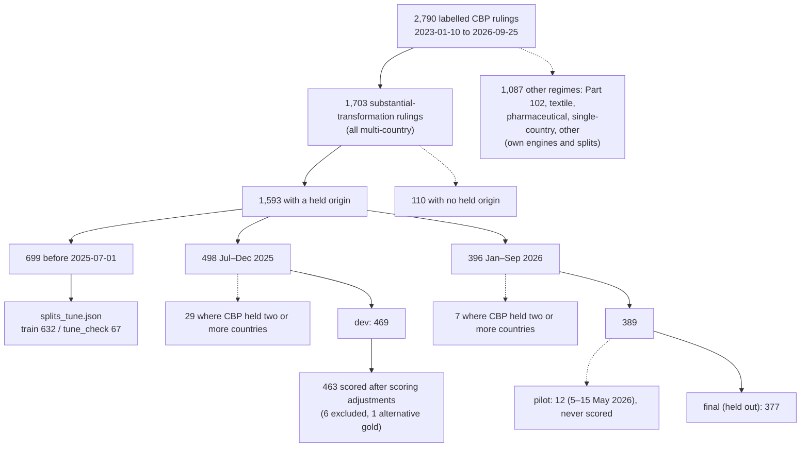
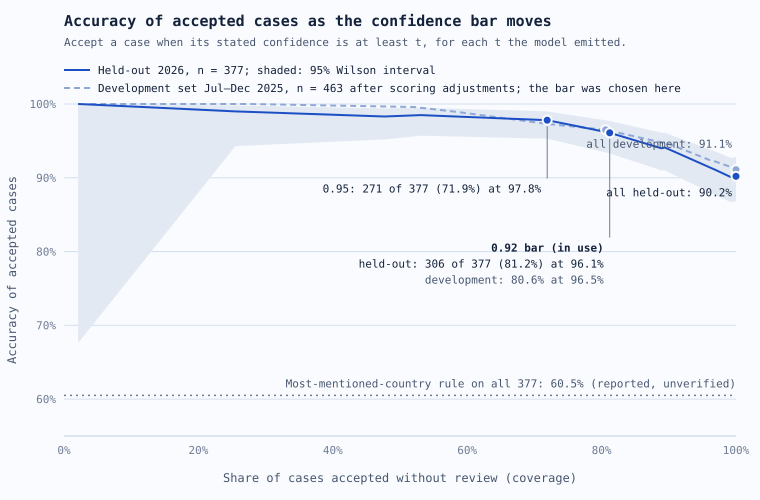

# How the evaluation is built, traded off and benchmarked

This page answers three questions: how the validation and test sets are built, what we trade off in the results, and how we keep the benchmark honest. Every number here comes from a committed file. The figures and the calibration numbers are rebuilt by one script with no model calls:

```bash
python3 -I eval/charts/build_evaluation.py .           # writes eval/results/evaluation-metrics.json and docs/img/*.svg
python3 -I eval/charts/build_evaluation.py . --check   # fails if those files are stale
cd backend && go run ./cmd/claimscheck                 # recomputes the headline counts and checks docs/claims-reconciliation.md
```

Status words follow [NUMBERS.md](NUMBERS.md): **measured** means recomputed from committed rows; **reported** means stated in a committed document but not recomputable here; **planned** means not done.

## 1. What we measure and why

A user gives the engine a product description and gets back a country of origin, a confidence and the earlier CBP rulings it relied on. They make one decision from that answer: **accept it, or send the case to a customs expert.** The product makes that decision with a bar. A case with confidence at or above 0.92 that the router places in scope is auto-accepted (the fast path); everything else goes to expert review.

So we measure three things, in this order:

1. **Accuracy on every case**: does the predicted origin match the origin CBP held?
2. **Accuracy of the cases we accept, and how many we accept**: the fast path's accuracy and coverage. A wrong auto-accepted answer is the costly error, because nobody checks it.
3. **Whether the confidence means what it says**: calibration.

Cost per case and latency are measured on the same rows. The planner's precedent check has its own, smaller evaluation (section 3.2).

## 2. How the validation and test sets are built

### 2.1 From 2,790 rulings to the splits

The source is 2,790 CBP rulings dated 2023-01-10 to 2026-09-25 from rulings.cbp.gov (`eval/data/labels.jsonl`). Each row has the ruling date, the origin regime, CBP's held origin and how that label was extracted. The counts below are measured by `eval/charts/build_evaluation.py` (`funnel` in `eval/results/evaluation-metrics.json`).



| Step | Before dev (to 2025-06-30) | dev window (Jul–Dec 2025) | final window (2026) |
|---|---:|---:|---:|
| Substantial transformation, multi-country, a held origin | 699 | 498 | 396 |
| CBP held two or more countries ("A or B") | 27 | 29 | 7 |
| Single held origin | 672 | 469 | 389 |
| Pilot cases removed | — | — | 12 |
| **In the split** | train 632 + tune_check 67 | **dev 469** | **final 377** |

The two eval splits are frozen in `eval/splits/splits_final.json` (frozen 2026-10-14). Both contain only single-origin substantial-transformation rulings.

| Split | n | Dates | Collections | Labels | Use |
|---|---:|---|---|---|---|
| dev | 469 (463 scored) | 2025-07-01 to 2025-12-31 | 454 NY, 15 HQ | 448 regex, 21 manual | choose prompts, the bar, the router |
| final (held out) | 377 | 2026-01-02 to 2026-09-25 | 364 NY, 13 HQ | 355 regex, 22 manual | scored with the frozen configuration only |
| pilot | 12 | 2026-05-05 to 2026-05-15 | 10 NY, 2 HQ | 12 regex | taken out of 2026 before the freeze; never scored |
| train / tune_check | 632 / 67 | before 2025-07-01 | — | — | fine-tuning experiment only (`backend/cmd/eval/tune.go`, `tuneSplit`; 10% by FNV-1a hash of the ruling ID) |

Other splits, each built by a committed script and frozen before its held-out run:

- **Textile** (`eval/splits/splits_textile.json`, `build_textile_split.py`): dev 99, final 71.
- **Pharmaceutical** (`splits_pharma.json`, `build_pharma_split.py`) and **Part 102** (`splits_usmca.json`, `build_usmca_split.py`): final 56 and 32.
- **Regression slice** (`eval/splits/slice30.json`): 30 dev rulings stratified by confidence band (`backend/internal/evalslice`, `Pick`).

### 2.2 The exclusions, reconstructed

The script that cleaned 396 eligible 2026 rulings to 389, and 498 to 469 in the dev window, is not in this repository. We reconstructed it from `labels.jsonl` alone. One rule reproduces both counts exactly: **drop rulings whose held origin names two or more countries** (stored as `"A | B"`, for example "the body spray mists will be Singapore or Thailand"). Every excluded ruling has such a label, and every such ruling in those windows is excluded. There is no single right answer to score these against, so leaving them out is defensible. It does mean the benchmark is silent on the "it depends" cases.

Two more steps are documented:

- **Pilot.** 12 May 2026 rulings were used to try the pipeline before the freeze and were then removed from final. They have never been scored.
- **Scoring adjustments** (`eval/data/scoring_adjustments.json`, D23), applied identically to every run. Six dev rulings are excluded: four multi-scenario holdings, one revocation covering two products with different origins, and one holding "the country where the blanks are worked". One dev ruling (N354448) accepts either of two countries. A scan of final flagged one ruling (H360070); its label was correct, so nothing changed. Final has no adjustments.

One mismatch we found: the tune split's `rule` says "single-origin", but 27 of its 699 rulings carry a two-or-more-country label. The tune split only fed a fine-tuning experiment that was not adopted (section 3.3), so no reported accuracy depends on it.

### 2.3 Leakage controls

| Control | What it does | Where |
|---|---|---|
| Date split | dev ends 2025-12-31; final starts 2026-01-02 | `splits_final.json`; checked by claimscheck (`temporal.final_starts_after_dev_ends`) |
| Precedents strictly earlier | a retrieved precedent must be dated before the case, and is never the case itself or a ruling the case excludes | `domain.Ruling.UsableAsPrecedentFor`, `retrieval.PrecedentFilter`; claimscheck counts 0 of 1,885 held-out precedent slots on or after their case |
| Facts only | the engine reads the facts section, cut at the first legal-analysis cue; sentences that state the origin conclusion are redacted | `corpus.SplitFacts` |
| Held-out gate | `eval run -split final` refuses to run without `-confirm-final` and prints "do not change prompts, thresholds or retrieval because of its result" | `backend/cmd/eval/main.go` |
| Run log | every run appends its config, git revision and a `held_out` flag to `eval/results/RUNLOG.jsonl` | `eval/results/RUNLOG.jsonl` |

**Known leak paths, measured:**

- **Earlier held-out rulings can be precedents for later ones.** The filter is by date, not by split. 414 of the 1,885 retrieved precedent slots on final are themselves final rulings, touching 209 of 377 cases ([claims-reconciliation.md](claims-reconciliation.md) §4.2). A case never sees its own holding, but it can see a February 2026 holding when the case is from May. This matches how the product works (it uses every earlier ruling), but it is not a fully sealed test set.
- **BM25 statistics** (IDF, average length) are computed over the whole corpus, including later rulings (D10). That leaks term counts, not text or holdings.
- **Model pre-training** may have seen some 2026 rulings. We cannot exclude that.

### 2.4 Labels: where they come from and how they were checked

The label is **CBP's stated holding**: the origin CBP held in the ruling, not our opinion of the right answer.

- 2,696 labels are extracted by regex from the holding sentence; 94 were set by hand where the regex failed. On final, 355 are regex and 22 manual. Accuracy by label method on final: regex 321/355 = 90.4% (86.9–93.1), manual 19/22 = 86.4% (66.7–95.3) (`eval/RESULTS.md`).
- Reported quality checks: a second extractor and a 30-item audit, not an expert panel ([DETAILS.md](DETAILS.md#limitations)). The audit records are not in this repository.
- Six labels the model, acting as a judge, called wrong were checked by hand against the ruling text. All six matched CBP (D23).
- Data files are pinned by `eval/SHA256SUMS` (`make verify-data`).

## 3. What we trade off

### 3.1 Accuracy against coverage: the confidence bar



Measured, `eval/results/evaluation-metrics.json` (`selective`). The curve accepts on confidence alone. The production fast path also requires the router to place the case in scope, which removes 6 more held-out cases.

| Rule | Held-out: accepted | Held-out: accuracy of accepted | Development set (adjusted) |
|---|---|---|---|
| accept everything | 377 (100%) | 90.2% (86.8–92.8) | 91.1% (88.2–93.4) |
| confidence ≥ 0.92 | 306 (81.2%) | 96.1% (93.3–97.7) | 373 (80.6%) at 96.5% |
| **confidence ≥ 0.92 and in scope (fast path, in use)** | **300 (79.6%)** | **96.0% (93.1–97.7)**, 12 wrong | 368 (79.5%) at 96.5% (94.1–97.9) |
| confidence ≥ 0.95 | 271 (71.9%) | 97.8% (95.3–99.0) | 333 (71.9%) at 97.3% |
| confidence ≥ 0.95 and in scope (the old fast path) | 266 (70.6%) | 97.7% (95.2–99.0), 6 wrong | not recomputed here |

**The choice.** We moved the bar from 0.95 to 0.92 (D32). The rule was the lowest bar at which accuracy of accepted cases stays at or above 95%. It was chosen on the proxy dev run; held-out confirmed it and was not used to search for it. On held-out, the cost is 1.7 points of accuracy on accepted cases (97.7% to 96.0%) for 9 points more coverage (70.6% to 79.6%). That is 34 more cases that skip review, and 6 more wrong answers auto-accepted: 12 in all, 3.2% of every held-out case. The intervals of the two rules overlap.

**Not adopted:** per-product-family bars fitted on dev (D63). On held-out they covered less (76.1%) at lower accuracy (94.1%), with 17 wrong auto-accepts instead of 12 (`eval/RESULTS.md`).

For scale only: the most-mentioned-country rule scores 60.5% on all 377 cases. That figure is reported, unverified: its source is not in this repository. It is a number on all cases, so it is not compared with the fast path, which is a subset the model chose.

### 3.2 Precision against recall in the planner's precedent check

A plan is shown only if the precedent check finds an earlier ruling where CBP treated the same kind of change as decisive, at verifier confidence 0.92 or more. We set this strictly on purpose: a wrong "this move works" costs the user a factory move.

| | Result | Source |
|---|---|---|
| verifier-v1, 54 dev flip pairs | precision 34/34 (90–100), recall 34/46 = 74% (60–84), specificity 8/8 | `eval/RESULTS.md` |
| verifier-v2 (current), same pairs | precision 32/32 (89–100), recall 69.6% (55.2–80.9), specificity 8/8 | `flips-dev-verifier-v2-unknown-a-litellm.jsonl` |
| every v2 run pooled, at the 0.92 bar (D86) | 182 verdicts shown, 0 wrong (dev 159, 2026 pairs 23) | `eval/results/flips-*-verifier-v2*` |
| pair level, dev | 13 of 46 real changes shown in every run (28%); 11 more in some runs; no no-change pair ever shown | D86 |

**The choice.** Precision over recall. About 30% of real origin changes clear the bar. The rest are not dropped: they go to a broker as "below the bar", with the closest supporting ruling. All of these are proxy runs on development pairs; the 2026 pairs are not a clean held-out test (section 5).

### 3.3 Model size against cost and latency

All on the development set (adjusted, n = 463), same engine-v1 prompt, BM25, K = 5. Paired comparisons use an exact McNemar test on the cases where the two models disagree.

| Model | Accuracy | Fast path (≥ 0.92) | Latency p50 / p95 | Cost / case | vs Argon |
|---|---|---|---|---|---|
| **Gemini 4 Argon (in use)** | 91.1% (88.2–93.4) | 79.5% at 96.5% | 4.8 s / 8.1 s | $0.0079 promo | — |
| Gemini 3.8 Flash (fallback) | 90.1% (87.0–92.5) | 87.7% at 93.1% | 5.5 s / 21.6 s | not priced | fixed 13, broke 18, p = 0.473 |
| Gemini 3.5 Flash, untuned | 90.5% (87.5–92.8) | 91.6% at 92.0% | 12.1 s / 51.2 s | $0.017 | fixed 16, broke 19, p = 0.736 |
| Gemini 3.5 Flash, fine-tuned | 87.9% (84.6–90.6) | 94.0% at 89.4% | 6.0 s / 17.1 s | $0.0248 | fixed 15, broke 30, p = 0.036 |

Source: `eval/RESULTS.md` and `eval/results/dev-*-vertex.jsonl`.

**The choice.** Argon. Overall accuracy does not separate the base models (p ≥ 0.47). What separates them is the confident subset: only Argon keeps the fast path at or above the 95% the bar is set for, and it has the lowest tail latency. The Flash models say "confident" more often and are wrong more often when they do. Fine-tuning made accuracy significantly worse (p = 0.036), so it was dropped. None of these alternatives was run on held-out.

### 3.4 Retrieval and prompt complexity against gain

Every change below was tried on dev, paired against the plain engine, and **not adopted**. These were proxy runs (LiteLLM, same Argon model).

| Change | Dev accuracy | Fixed / broke | p | Cost / case |
|---|---|---|---|---|
| Baseline: BM25, 5 precedents (n = 469) | 90.0% | — | — | $0.0079 |
| BM25 top 30 re-ranked by embeddings | 88.9% | 7 / 12 | 0.36 | $0.0078 |
| Embedding retrieval only | 89.8% | 5 / 6 | 1.00 | $0.0077 |
| 5 votes over precedent orders when confidence < 0.95 | 89.6% | 2 / 4 | 0.69 | $0.0169 |
| Written CBP rules for the confident errors (n = 463) | 91.1% vs 90.9% | 10 / 9 | 1.0 | — |
| CBP's reasoning shown with each precedent (n = 463) | 91.4% vs 90.9% | 7 / 5 | 0.77 | $0.0095 vs $0.0084 |

Source: `eval/RESULTS.md`, D22, D27, D28.

**The choice.** Keep plain BM25 and one call. No change moved accuracy by more than half a point, and none was significant. The added parts cost money or latency for no measured gain. The held-out split was therefore not re-scored for any of them.

## 4. How we benchmark properly

### 4.1 What is in place (built)

- **Frozen protocol.** Engine-v1, BM25, K = 5, Gemini 4 Argon, router-v2, bar 0.92 were fixed before the held-out run. The split file records its freeze time.
- **Held-out scored with a gate.** `-confirm-final` is required. The engine's held-out split appears twice in `RUNLOG.jsonl`, both with the frozen configuration: once through the proxy (89.9%) and once on Vertex AI (90.2%, the official figure). Nothing changed between them (McNemar p = 1.0). The specialist engines each have one held-out run.
- **Intervals on every proportion.** 95% Wilson intervals (`backend/internal/evalkit`, `Wilson`). Small-n numbers are never shown without one.
- **Paired tests for comparisons.** Two runs on the same cases are compared with an exact McNemar test on the discordant cases (`eval compare`; `mcnemarExact` in `backend/cmd/eval/main.go`), not by eyeballing two accuracies.
- **Repeatable calls.** Temperature 0 on every model call, and since 17 Oct a fixed seed, 20261017 (`llm.Seed`, D76). The official held-out run (15 Oct) predates the seed. Google treats the seed as best effort.
- **Resumable, logged runs.** Every run appends its model, prompt version, provider, K, git revision and held-out flag to `RUNLOG.jsonl`. Every per-case row records the model and prompt version it used.
- **Independent recomputation.** `go run ./cmd/claimscheck` recomputes the headline counts from the committed rows, checks the checksums of every file it reads and fails if [claims-reconciliation.md](claims-reconciliation.md) states a different value. It runs offline with the standard library only.
- **Prompt fingerprints.** `backend/internal/promptsnap` fails the tests when a prompt's text changes but its version name does not, so a recorded `prompt_version` always means the same text.
- **Regression slice.** `eval-slice.yml` runs the engine on the 30-case slice on Vertex after a push to main that touches the engine, router, clarify or verifier. It fails if more than 2 cases are lost or if accuracy at confidence ≥ 0.95 falls under 95%. Pull requests get the offline prompt-fingerprint check instead, because they have no model credentials.

### 4.2 Calibration, computed now

The per-case held-out and dev rows include the stated confidence, so calibration needs no model calls. Measured by `eval/charts/build_evaluation.py` (2,000 bootstrap resamples, seed 20261017, percentile intervals):

| | Held-out (n = 377) | Development set (n = 463, adjusted) |
|---|---|---|
| Accuracy | 90.2% | 91.1% |
| Mean stated confidence | 94.7% | 94.9% |
| ECE, one bin per emitted confidence value | 0.059 (0.041–0.091) | 0.050 (0.033–0.078) |
| ECE, 10 equal-width bins | 0.046 (0.022–0.074) | 0.038 (0.016–0.063) |
| Brier score | 0.081 (0.059–0.105) | 0.072 (0.051–0.094) |
| Brier of a constant forecast at the accuracy rate | 0.089 | 0.081 |


What this says:

- **The confidence is overconfident by about 4.5 points on average** (94.7% stated, 90.2% observed).
- **Above the bar it is close to calibrated.** At 0.95 and above, observed accuracy is 95.8% to 100% per value.
- **Just below the bar it is not.** Cases scored 0.92 are right 29/35 = 82.9% of the time; 0.90 is 21/29 = 72.4%; 0.85 is 16/29 = 55.2%. These go to review, which is where they belong.
- **The confidence ranks cases better than it states probabilities.** The Brier score is only about 9% better than a constant forecast. Its value is in ordering cases, which is what the bar uses.

The model emits about 11 distinct confidence values, so the first ECE uses one bin per value. The standard 10-bin ECE puts every case from 0.90 to 1.00 in one bin and reads lower. ECE on a few hundred cases is biased upward; the intervals show how wide it is.

### 4.3 What we'd add next (planned)

- **Multi-run variance.** The official engine numbers are one scored run. Earlier proxy runs moved fast-path coverage by about 3 points between runs (`eval/RESULTS.md`). Three or more seeded runs on dev would give a measured spread.
- **Bootstrap intervals for paired differences**, alongside McNemar, so the size of a difference gets an interval and not only a p-value.
- **A recalibration step** (for example isotonic on dev, checked on held-out) if the product starts showing confidence as a probability. Today it is only compared with a bar.
- **A clean planner test set** from CBP rulings published after 25 Sep 2026, once enough exist with an origin holding (D82).
- **Re-running the specialist engines on Vertex.** The pharmaceutical and Part 102 held-out numbers are proxy runs.
- **Committing the baseline computation**, so the 60.5% figure can be reproduced or dropped.

## 5. Known gaps

- **Confidence is a self-report.** It is overconfident on average (section 4.2) and is used only as a ranking against a bar.
- **One scored run** per configuration on held-out. Run-to-run variance is not measured for the official numbers.
- **Baselines are unverified.** 60.5%, 40.6%, 39.8% and 12.2% are reported from a research document that is not in this repository.
- **The split's cleaning script is not committed.** We reconstructed the rule (section 2.2) and it reproduces the counts exactly, but it is a reconstruction.
- **The test set is not sealed against itself.** Earlier held-out rulings serve as precedents for later ones (414 of 1,885 slots).
- **The benchmark leaves out "A or B" holdings** (36 in the dev and final windows), which are real and harder cases.
- **Labels are one pipeline plus a small audit**, not an expert panel, and the audit records are not committed.
- **Inputs are CBP's restatements** of each request, not raw manufacturer BOMs. Real inputs will be messier.
- **The planner is the least tested part.** Its precedent check has only development pairs and 2026 pairs that informed its prompt. There is no post-25-Sep test yet.
- **Proxy runs.** Pharmaceutical and Part 102 held-out numbers, every ablation in section 3.4 and every precedent-check result came through the LiteLLM proxy with the same Gemini model, not the official Vertex AI path.
